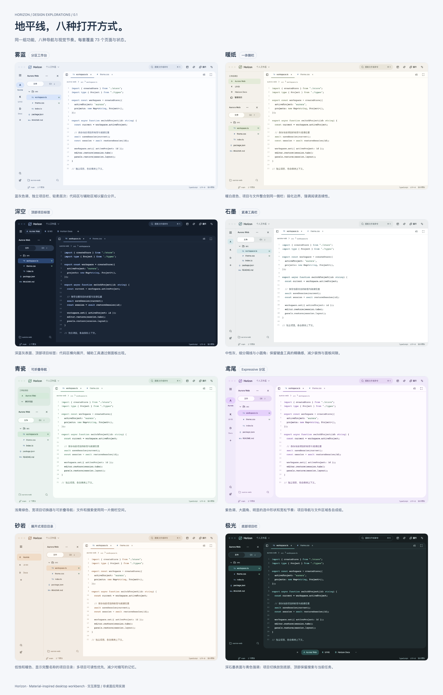

# Horizon · 地平线

A lightweight, customizable, AI-ready code workbench for macOS and Windows.

面向以阅读代码、审查改动、管理项目为主的开发者。默认显示工作区、项目、文件树与高亮代码；Git 随手可用。插件系统是核心架构，插件中心有固定入口；具体能力按需安装、启用和运行。

**试用安装：[Windows x64](docs/WINDOWS_TRIAL.md) · [macOS 本机包说明](docs/MACOS_CANDIDATE.md)。**

**当前阶段：桌面首版功能验收与 Windows 试用版构建。** 应用代码位于 `apps/desktop/`，共享能力位于 `packages/`。`design/` 继续保留独立交互原型；原型中的演示数据不代表真实桌面验收结果。实际测试记录逐项写入 `docs/verification/`。



## 先看设计

- **[交互图集](design/index.html)**：下载或克隆后，用浏览器打开。8 套布局/主题组合 × 73 个页面与状态。
- **[设计图目录](design/exports/index.html)**：584 张 PNG，可按风格和场景分组浏览。
- **[设计总览 PDF](design/exports/pdf/horizon-design-overview.pdf)**：八套核心场景对照。
- **[全部页面索引](design/SCREEN_INDEX.md)**：稳定编号、场景与设计要点。
- **[视觉设计规范](design/DESIGN_SYSTEM.md)**：配色、导航、组件、尺寸、响应式与交付约定。

| 方向 | 导航与视觉特点 | 完整设计册 |
| --- | --- | --- |
| 雾蓝 | 独立项目栏，柔和分区，蓝灰层次 | [PDF](design/exports/pdf/horizon-mist.pdf) |
| 暖纸 | 项目与文件合并侧栏，暖白阅读表面 | [PDF](design/exports/pdf/horizon-paper.pdf) |
| 深空 | 顶部项目标签，深蓝灰，横向代码空间 | [PDF](design/exports/pdf/horizon-orbit.pdf) |
| 石墨 | 紧凑工具栏，小圆角，清晰细线 | [PDF](design/exports/pdf/horizon-graphite.pdf) |
| 青瓷 | 可折叠项目目录，浅青绿色，柔和大面板 | [PDF](design/exports/pdf/horizon-celadon.pdf) |
| 鸢尾 | Expressive 分区，大圆角，宽松节奏 | [PDF](design/exports/pdf/horizon-iris.pdf) |
| 砂岩 | 展开式项目目录，完整名称，低饱和暖色 | [PDF](design/exports/pdf/horizon-sand.pdf) |
| 极光 | 底部项目切换，深石墨表面，青色强调 | [PDF](design/exports/pdf/horizon-aurora.pdf) |

八套预设全部按布局插件交付，主题独立选择。设置可调整侧栏、顶部、文件标签等区域尺寸，导入本地背景图片、自配浅深颜色并保存外观组合；业务逻辑共用。

## 插件中心

[直接打开插件中心](design/index.html?screen=plugins) · [插件设计册](design/exports/pdf/horizon-plugins.pdf) · [插件中心设计规范](design/PLUGIN_CENTER.md)

15 个场景覆盖发现、已安装、详情与贡献点、安装、授权、项目配置、更新、权限变化、运行与休眠、失败诊断、停用、卸载和开发者模式。八套风格同步提供；安装、启停、更新和卸载可在本地原型中连续演示。

## UI 定制

[外观设置](design/index.html?screen=settings-appearance) · [布局插件](design/index.html?screen=settings-layout) · [UI 定制设计册](design/exports/pdf/horizon-customization.pdf)

布局、主题、区域尺寸、本地背景和浅深配色独立组合，外观与字体全局共用，可保存命名组合；缩进、自动保存等编辑行为允许项目覆盖。原型偏好保存在浏览器本地；真实桌面资产与配置机制见技术文档。

## 覆盖内容

开始与项目、代码阅读和轻量编辑、文件搜索、Git 差异和提交、冲突处理、项目 AI 对话、任务审查、终端、扩展、设置，以及加载、空白、错误、休眠、专注、深色、窄窗口和 Windows 窗口。图集中也包含信息架构、视觉令牌、组件状态、布局规则与关键流程图。

## 文档

**[使用指南](docs/USER_GUIDE.md)** · **[编码入口](docs/README.md)** · **[开工审查](docs/implementation/READINESS.md)** · [插件开发](docs/developer/EXTENSIONS.md) · [插件研究](docs/architecture/PLUGIN_SYSTEM_RESEARCH.md) · [UI 定制设计](docs/ux/CUSTOMIZATION_DESIGN.md)

- [产品设计](docs/product/PRD.md)
- [交互与状态规范](docs/ux/INTERACTION_SPEC.md)
- [技术架构](docs/architecture/TECHNICAL_DESIGN.md)
- [实施计划](docs/implementation/IMPLEMENTATION_PLAN.md)
- [前期调研 HTML](research/lightweight-workbench-research.html) / [PDF](research/lightweight-workbench-research.pdf)

当前技术方向为 Tauri 2 + Rust + React / TypeScript + CodeMirror 6 + Cordis core。技术文档中区分已确认选择、建议指标与待验证部分。早期研究及 `design/archive/` 保留探索过程；当前实现基线以 docs/README.md 与 0.4 文档为准。

## 本地使用

桌面开发：`npm ci` 后运行 `npm run desktop`。macOS 需要 Rust 与 Xcode Command Line Tools；Windows 需要 Rust MSVC 与 Visual Studio C++ Build Tools，见 [Windows 构建说明](docs/WINDOWS_TRIAL.md)。`npm run desktop:build` 检查并构建前端；`npm run desktop:release` 构建本机应用；macOS DMG / ZIP 输出到 `artifacts/macos/`，Windows NSIS / MSI 输出到 `apps/desktop/src-tauri/target/release/bundle/`。桌面功能与安装交付以验收报告为准。

打包应用无需 Node.js 或 Rust。Git 功能依赖本机 Git，可在“设置 → Git”配置并检测路径；缺少 Git 不阻断本地阅读、编辑与搜索。Pi runtime 按需安装，详见[使用指南](docs/USER_GUIDE.md)。

macOS 开发和 release 入口会调用 Xcode Command Line Tools 的 `swiftc` 构建文件选择服务，并随应用打包；只构建应用、不生成安装包可运行 `npm run desktop:release -- --bundles app`。

直接打开 `design/index.html` 即可离线查看，无需安装依赖。

源码构建需要 Node.js 20.19+（20.x）或 22.12+，建议使用本次验证采用的 Node.js 24。重新导出设计图还需 npm、Python 3 和 Playwright Chromium：

```sh
npm ci
npx playwright install chromium
npm run build
npm run preview
```

浏览器访问 `http://localhost:4173`。页面也支持 `?style=paper&screen=git-changes`，便于分享具体设计位置。

```sh
npm run check    # 页面渲染、主要交互和响应式检查
npm run check:plugins # 插件生命周期、项目作用域与窄窗口检查
npm run check:customization # 布局/主题、尺寸、图片、继承与组合检查
npm run capture  # 重新导出 584 张 PNG、11 份 PDF、总览与图册
```

## 目录

```text
apps/desktop/      Tauri macOS / Windows 桌面应用
apps/git-service/  按需 Git 服务
apps/extension-host/ QuickJS 隔离扩展宿主
apps/picker-service/ macOS 按需原生文件选择服务
packages/          插件内核、编辑器、外观与 Pi 策略
artifacts/macos/   本机应用安装包（构建产物）
design/
  source/          可编辑的结构、样式、交互、场景与风格数据
  index.html       独立交互图集
  assets/          本地图标资源及许可证
  exports/         PNG、PDF、总览、静态设计图目录
  archive/         早期探索稿
docs/              产品、交互、架构与实施文档
research/          前期调研与原型资料
scripts/           构建、检查与导出脚本
.work/             本地检查中间文件（不纳入 Git）
```

## 开源

[MIT](LICENSE)。第三方资源见 [THIRD_PARTY_NOTICES.md](THIRD_PARTY_NOTICES.md)。Horizon 为独立项目；名称灵感来自地平线意象及喜爱的游戏角色，界面与图标使用本项目设计和 Lucide 资源。
