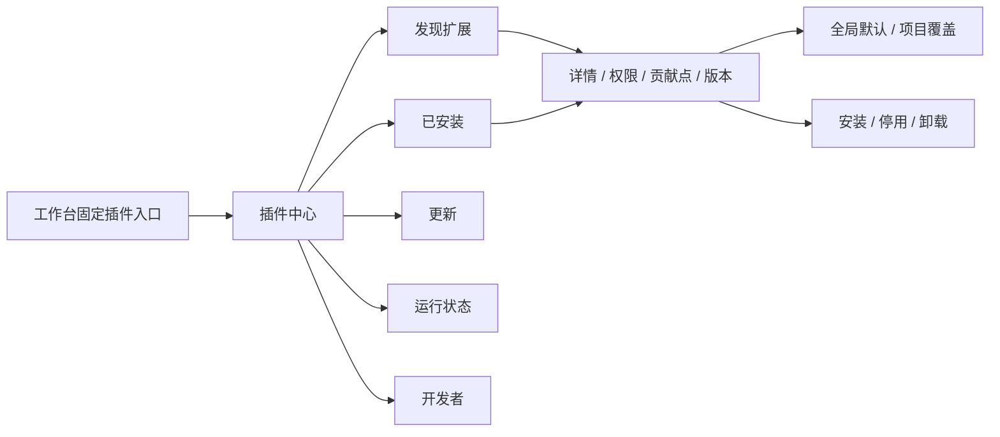

# 插件中心：核心产品能力

版本 0.2 · 2026-10-31。

Horizon 的插件系统负责让工作台按需要组合能力。插件中心在顶栏保留固定入口，与项目、Git、AI 和设置一起构成主流程。扩展注册、配置与状态管理属于产品核心；具体插件按触发条件加载。

[交互入口](index.html?screen=plugins) · [插件设计册](exports/pdf/horizon-plugins.pdf) · [全部原尺寸图](exports/index.html)

## 1. 信息架构

- **发现扩展**：按语言、阅读、工具、主题、Git 分类；搜索名称、能力和作者；安装入口就近放在扩展卡片。
- **已安装**：显示当前安装版本、有效作用域、启用状态与激活条件。启用、停用和详情在同一条目内操作。
- **更新**：显示当前版本、目标版本、变更摘要及权限差异。普通更新与新增权限的更新分别处理。
- **运行状态**：查看活动、休眠、待激活、停用和失败的扩展，支持停止、唤醒、重试及日志。
- **开发者**：加载本地目录、检查清单、重新加载和访问运行日志，让开源扩展能形成开发闭环。

发现页中的插件名称、作者、版本与数据是设计样例。目前提供本地扩展包安装流程；公开扩展市场的托管、审核、索引和更新服务另行实现。

## 2. 三个独立状态

| 维度 | 状态 | 用户需要知道的事 |
| --- | --- | --- |
| 安装 | 未安装、安装中、已安装、可更新、卸载中 | 本机是否有扩展包，当前是哪一版 |
| 启用 | 全局启用、项目覆盖、已停用 | 哪些项目允许该扩展贡献入口或执行能力 |
| 运行 | 未启动、待激活、运行中、已休眠、启动失败、无需进程 | 当前是否有服务在工作，何时会启动 |

主题等声明式资源显示“无需进程”。已启用的语言扩展可以显示“已休眠”。安装完成后显示“待激活”，不为了更新状态就启动所有服务。

关闭面板只改变显示；停止操作结束当前服务；停用移除贡献入口并阻止再次激活；卸载移除包文件。四者分别提供明确动作和反馈。

## 3. 作用域与设置

安装包属于应用。全局启用是默认值；项目可以覆盖启用状态和插件配置。项目覆盖优先于全局默认，提供“恢复继承全局”操作。

在当前项目停用时，其他项目继续沿用自己的覆盖或全局默认。对所有项目执行停用时，应明确显示影响范围。插件详情与已安装列表都展示当前有效范围。

插件设置由插件提供结构化声明，宿主使用一致的表单组件渲染。初期覆盖选择、开关、文本与路径字段；设置搜索和错误说明沿用宿主规则。具体插件可定义语言服务、格式化、预览等参数。

## 4. 安装流程

1. 从扩展条目或“安装扩展包”进入。
2. 查看名称、ID、来源、版本和兼容性，选择启用范围。
3. 查看声明权限、具体用途和有效范围。授权选择默认未勾选。
4. 明确同意后开始安装，展示检查、授权、安装文件、注册入口四个步骤。
5. 安装完成后回到已安装列表，显示“待激活”。

取消安装不会启用未完成的扩展。安装失败保留足够的诊断信息与重试入口。兼容性、来源、权限与版本检查由真实扩展宿主负责，原型不处理磁盘中的扩展包。

## 5. 更新、停用和卸载

**更新。** 卡片显示 `当前版本 → 目标版本`。沿用权限的更新可以直接执行；新增权限的更新显示原有权限与新增项，重新确认。暂不更新时继续保留当前版本。失败时保留旧版本与配置。

**停用。** 弹窗说明作用域、入口移除与服务停止；保留包文件和配置。可在已安装列表重新启用。

**卸载。** 显示扩展名称、版本与范围，允许保留配置供重新安装使用。卸载不删除项目中的源码。取消返回原管理上下文。

## 6. 运行与资源

默认以可解释的状态管理资源，不填入未经采样的内存数字。运行页显示激活条件、当前状态和可执行动作。真实桌面宿主接入监测后，可进一步展示进程、内存与启动耗时，必须明确测量范围。

- 终端：打开面板时按需创建会话；结束进程与收起面板分别控制。
- 语言服务：打开支持的源文件时触发；可恢复的后台服务在项目休眠后停止。
- Markdown：打开预览时加载；关闭预览后释放对应资源。
- 主题：声明式资源，无独立服务进程。

失败状态保留错误原因与最近日志，允许重试、停用或进入详情。日志的路径、命令和项目身份来自实际运行环境，不能在正式产品中使用固定演示文本。

## 7. 扩展贡献点

| 贡献点 | 界面位置与示例 |
| --- | --- |
| 命令与快捷键 | 命令面板、新建终端、格式化文档、打开预览 |
| 侧栏视图 | 文件结构、任务列表、自定义导航 |
| 底部面板 | 终端、输出、问题与诊断 |
| 编辑区 | Markdown 预览、Diff 辅助、语言能力 |
| 主题与图标 | 颜色、字体、密度、图标资源 |
| 设置 | 插件专属配置与项目覆盖 |

开发者页展示清单样例、激活事件、贡献点及权限。包格式、清单协议、宿主隔离与 API 以技术设计中的正式接口为准；界面里的清单是用于说明流程的示例。

## 8. 页面清单

| 编号 | 场景 |
| --- | --- |
| E02 | 插件中心 · 发现扩展 |
| E03 | 插件详情与贡献点 |
| E04 | 扩展失败与诊断 |
| E05 | 已安装与作用域 |
| E06 | 本地扩展包安装 |
| E07 | 安装进度与取消 |
| E08 | 首次安装授权 |
| E09 | 插件设置与项目覆盖 |
| E10 | 更新管理 |
| E11 | 更新权限变化 |
| E12 | 运行与休眠管理 |
| E13 | 停用范围确认 |
| E14 | 卸载与配置保留 |
| E15 | 没有已安装扩展 |
| E16 | 开发者模式与贡献点 |

以上 15 个场景在八套视觉方向中均可查看，提供 120 张原尺寸图。E01 为按需终端，独立归入“终端”分组，编号保持稳定。

## 9. 原型验证范围

原型实现本地内存中的安装状态、授权门槛、启停、更新、卸载、项目启用覆盖、分类与搜索，以及运行状态切换。切换八套视觉方向共用这些业务状态。

`npm run check:plugins` 覆盖八套风格中的完整生命周期、跨项目启用继承，以及 736 / 360 / 320 px 下全部插件场景的溢出检查。真实插件包验证、持久化、进程启动、网络和权限执行仍属于桌面实现。

## 0.4 定制入口

插件中心顶栏增加“布局与外观”入口，连接 F02 的八个布局插件及 F01/F10–F14 设置。布局包与主题包由正式安装/启停协议管理；原型的布局选择为预装资源演示，真实卸载/替代布局与恢复页由 TASK-035 验收。E15 已明确全部功能扩展卸载后保留宿主管理与默认包恢复入口。
