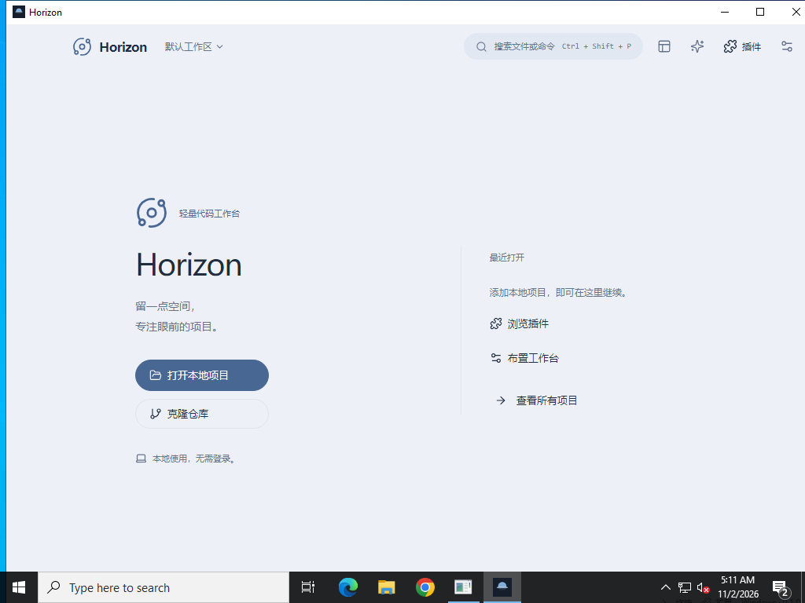

# Horizon Windows 试用版

面向 Windows x64。[当前试用版已发布](https://github.com/chenachen/horizon-workbench/releases/tag/windows-7ccf610fadae)，对应 commit `7ccf610fadaec22ceac7895cc6cbd70b9fe917fe`。后续构建见[发行列表](https://github.com/chenachen/horizon-workbench/releases)。

## 安装

下载 [setup.exe](https://github.com/chenachen/horizon-workbench/releases/download/windows-7ccf610fadae/Horizon_0.1.0_x64-setup.exe) 或 [MSI](https://github.com/chenachen/horizon-workbench/releases/download/windows-7ccf610fadae/Horizon_0.1.0_x64_en-US.msi)，选择一种安装即可。本次五个发布资产均已实际下载，大小与 SHA-256 匹配 GitHub 资产摘要；两份安装器也匹配 [SHA256SUMS.txt](https://github.com/chenachen/horizon-workbench/releases/download/windows-7ccf610fadae/SHA256SUMS.txt)。

| 安装器 | 字节数 | SHA-256 |
| --- | ---: | --- |
| setup.exe | 9,951,106 | `9926c4b1c3b2188a0ed36e23394a1efeb97127477a19a0813ddff378588481ab` |
| MSI | 14,324,194 | `61a15ce130cfe75629ad1c18ece5c8f3501f0ddbf798760baa56fac27edbb5c0` |

应用运行无需 Node.js 或 Rust。安装器会检查 WebView2；缺少时需要联网下载其安装程序。当前为未签名试用版，公司电脑能否安装取决于公司的软件策略。

Git 面板需要 Git for Windows。在“设置 → Git”检测 Git；未找到时选择本机 `git.exe`。项目阅读、编辑和搜索不依赖 Git。Pi 运行时在启用 AI 后单独安装，服务地址、模型与凭据由你配置。Pi 任务副本使用 PATH 中的 `git.exe`，因此需将 Git for Windows 加入 PATH；仅在 Git 设置中选择路径不会替代这一要求。

## 开始使用

1. 添加一个项目目录，用文件树或 `Ctrl+P` 打开文件；`Ctrl+S` 保存，`Ctrl+Shift+F` 搜索项目。
2. Git 面板先审查改动，再暂存和提交；推送是独立操作。
3. 终端和新建 Shell 启动步骤默认使用 PowerShell。启动自己的项目时，检查命令、工作目录和启动计划后再执行。
4. “设置 → 外观”调整布局、主题、字体和背景；外观在所有项目间共用。

更多操作见[使用指南](USER_GUIDE.md)。

## 验证范围

该构建完成 Windows 原生编译和双安装器生成；QuickJS、进程 Job、终端、存储、Pi 通信与凭据等 10 项测试各实际通过 1 次，包含 Windows 真实目录锁激活边界测试、终端中文输出与尺寸调整、停止回收，以及真实 Pi 运行时的受控短会话。

主进程启动 5 秒后仍存活，Horizon 窗口存在且响应；约 5.87 秒时首次观测到两份有效的宿主初始化配置文件。随后一次只读 UIA 查询为 `button_not_observed`；更晚的原生屏幕截图已确认欢迎页与打开项目、克隆、插件和设置入口可见。截图按 1024×768 屏幕裁切，底部含 Windows 任务栏。上述结果证明页面已绘制；按钮交互、安装器点击、IME 和 125%／150% 缩放仍未实测，也不代表启动时间达到 2 秒。完整结果见[本次冻结记录](verification/results/windows-ci-attempt15-7ccf610-window-png-20261102/README.md)和[原生构建记录](https://github.com/chenachen/horizon-workbench/actions/runs/41390901014)，macOS 功能记录见[验收入口](verification/README.md)。



此前 `a721bfc` 的一次 Windows CI 在 Pi 受管安装时返回 `Access is denied`；后续 `3545a01` 再次失败，已定位到解压和版本检测之后的运行时目录激活，Windows 返回 OS error 5。当前版本包含有界目录激活处理，受控真实目录锁边界测试与真实受管安装、短会话均已通过。原失败时实际持锁者仍未知，历史失败未改判；记录保留在[首次归档](verification/results/windows-ci-attempt09-pi-install-20261102/README.md)与[目录激活归档](verification/results/windows-ci-attempt12-rename-activation-20261102/README.md)。

macOS 本机首版条款与八套布局的适用视觉状态已完成验收；上述 Windows 未测项保持单列。你的模型供应商连接仍需在应用内测试。

## 从源码构建

Windows 构建需要 Node.js 24、Rust stable MSVC、Visual Studio C++ Build Tools 和 WebView2 开发前置条件，参见 [Tauri Windows 环境准备](https://v2.tauri.app/start/prerequisites/#windows)。

```powershell
npm ci
npm run desktop:release -- --bundles nsis,msi
```

安装器位于 `apps/desktop/src-tauri/target/release/bundle/`。CI 同时发布构建身份、SHA-256 与原始日志。
