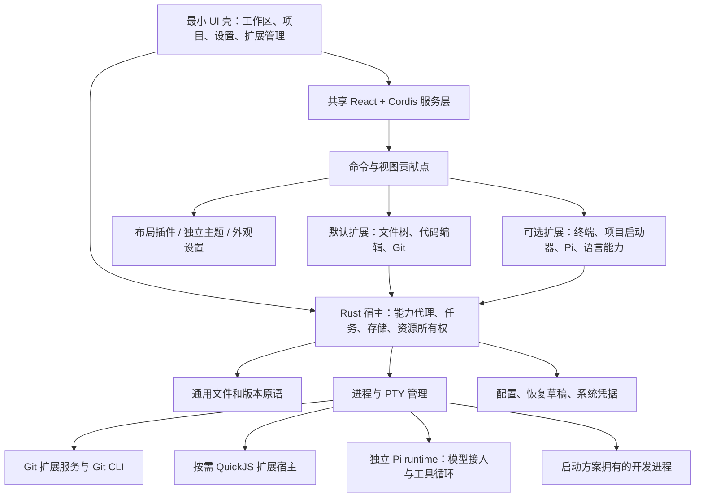

# Horizon 技术详细设计

| 项目 | 内容 |
| --- | --- |
| 文档版本 | 0.4.0，2026-10-31，Asia/Shanghai；2026-10-30 开始核验；插件优先与 Pi 候选基线 |
| 状态 | 实施设计建议；可以据此开始技术验证与核心编码；不是已实现功能说明 |
| 范围 | macOS、Windows 本地桌面工作台；工作区、多项目、文件、Git、可选 AI、按需扩展 |
| 所有者 | Horizon 架构基线；跨文档整合由本轮统一维护 |
| 配套契约 | [INTERFACES.md](INTERFACES.md)、[DECISIONS.md](DECISIONS.md)、[PI_AGENT_RESEARCH.md](PI_AGENT_RESEARCH.md) |
| 外部依赖 | 产品需求编号与交付优先级、交互状态、双端真机、系统 Git；公开发布另需签名身份 |
| 验收方式 | 本文各模块验收、TASK-ARCH 任务及性能场景；实现完成后记录实测，不用原型代替 |

## 1. 读取基线与设计假设

本稿依据当前 PRD/REQUIREMENTS、交互/组件、73 页源清单与最新 UI 定制要求。早期 Feather 研究及 design/archive 保留历史，不作为 React/Cordis、八套布局插件、Pi 首版范围的依据。接口、决策与专项研究共同构成 0.4 基线。

采用以下假设：

1. 工作区是项目集合，不对应一个必须存在的磁盘目录。项目首期对应一个本地根目录，可有多个项目；旧研究“首期单根工作区”不再作为领域模型依据。A02、A03、A04 优先。
2. 核心工作流是阅读、轻量编辑、Git 审查。AI、终端、语言服务、扩展代码在使用时启动，B01 默认关闭 AI 和终端。
3. 样式文件中的八种方向均为预装布局插件与独立主题的默认组合。它们同时包含颜色、密度与导航布局差异，不能仅实现八套配色后宣称完成。数据与服务不依赖具体导航方式。
4. 默认无账号、无云同步、无后端业务服务。远程连接只发生于用户配置的 AI、Git 远端和明确启用的更新检查。
5. “未来 mini VS Code”指能力可组合，不承诺 VSIX、VS Code API 或 Marketplace 兼容。
6. 第一阶段单主窗口。A06“在新窗口打开”保留窗口上下文契约，建议在核心闭环后交付；不为每个项目常驻一个 WebView。正式优先级由产品文档收敛。
7. 文件树、编辑器、Git 是默认附带扩展，同样可暂停、禁用、卸载；最小宿主只保留窗口、项目登记、扩展管理、授权、资源回收和数据保护原语。默认可用不代表不可拆。
8. 首版实现一个 Agent runtime 适配：Pi 候选；Horizon 不自研 Agent。终端和项目启动器都是扩展，共用宿主的进程所有权机制。

## 2. 架构结论与实现切分

采用 Tauri 2 + Rust + React/TypeScript + CodeMirror 6 + Cordis core 作为技术验证与核心开发基线。该选择来自 UI 定制能力、系统 WebView、现有编辑器行为与 Rust 本地服务的组合，不构成性能达标结论。Tauri 仍有核心、WebView 与相关系统进程；React 的细粒度订阅和 CodeMirror 的视口渲染也不消除文档与缓存成本。[Tauri 进程模型](https://v2.tauri.app/concept/process-model/)、[React 外部 store](https://react.dev/reference/react/useSyncExternalStore)、[CodeMirror 架构](https://codemirror.net/docs/guide/)



### 2.0 最小宿主与默认扩展

借鉴 DeepSeek Harness 的可组合生命周期与贡献点思想，不引入其 Agent 平台或复写其 Agent loop。[官方架构入口](https://www.deepseek.com/en/harness/)

| 不可卸载的宿主原语 | 默认附带、可卸载扩展 | 按需扩展 |
| --- | --- | --- |
| 窗口/设置/扩展管理与恢复入口；工作区、项目登记 | `horizon.explorer`：文件树、快速打开、搜索 UI 与索引策略 | `horizon.terminal`：终端渲染、会话命令 |
| extension registry、依赖解析、命令/视图/服务注册、版本协商 | `horizon.editor`：CodeMirror、语言高亮、标签与编辑命令 | `horizon.launcher`：项目启动方案与执行计划 |
| 文件句柄、条件写入、恢复快照、权限 broker | `horizon.git`：Git 发现/状态/队列/解析/提交 UI | `horizon.agent.pi`：Pi 安装/检测/RPC/策略桥与 AI 面板 |
| TaskRegistry、ProcessSupervisor、PTY 原语、系统凭据 | 默认主题资源（可替换；壳保留应急主题） | Markdown 预览、LSP、格式化、其它 Agent 适配 |

宿主不包含 Git parser、搜索产品策略、CodeMirror、模型 SDK、Agent 循环、终端 renderer 或开发脚本发现逻辑。文件版本和恢复原语保留在宿主，是为了编辑扩展故障/卸载时仍能保护文档；进程管理保留在宿主，是为了扩展崩溃后仍能停止它拥有的实例。禁用全部默认扩展后，仍能打开项目总览、设置、扩展管理和恢复草稿，出现“安装/启用文件查看器”，而不是白屏。

业务扩展以独立 manifest、版本、资源和可选服务 executable 分发。Git 的 Rust 业务实现位于扩展 sidecar，而不是与应用主二进制链接后冒称可动态卸载。文件树/编辑器不必各启动一个服务进程；它们调用宿主通用文件能力。原生平台原语可以静态链接，但无扩展租约时不保留 watcher、任务、PTY 或缓存。

### 2.1 前端职责

前端壳提供稳定挂载点，布局插件负责区域结构，Cordis 服务管理贡献点；扩展提供各自交互状态、虚拟列表、编辑器、diff 和 Agent 面板。前端代码不直接访问磁盘、执行进程、保存凭据或任意发送网络请求。CodeMirror 的 `EditorState` 是编辑扩展打开文档期间的文本真源，不把全文复制到全局 React 外部状态仓库。

建议模块：

| 模块 | 拥有的状态 | 可以依赖 |
| --- | --- | --- |
| `shell` | 当前工作区、项目、焦点、面板开关 | feature 控制器、commands、layout |
| `layout` / `theme` | 语义令牌、密度、导航预设、分隔条比例 | settings；不依赖 Git/AI |
| `projects` / `explorer` | 项目卡片、树的展开行、目录页缓存 | IPC、虚拟列表 |
| `documents` | 文档元数据、标签、EditorState/EditorView 生命周期 | editor adapter、IPC |
| `git` / `ai` / `extensions` | 各面板 view model；仅存当前页数据 | IPC、commands、通用列表与 diff |
| `settings` | 设置编辑草稿、校验、继承来源 | settings IPC；即时预览可撤销 |
| `ipc` | DTO、任务订阅、错误归一、结果过期判断 | Tauri API；不依赖 UI 组件 |
| `commands` | command ID、可用条件、快捷键、贡献点 | 回调；业务结果由 feature 拥有 |

每个 feature 暴露控制器，不跨 feature 导入组件内部状态。CodeMirror 采用 imperative adapter 挂载，不让响应式 effect 反复创建编辑器。关闭视图必须 `destroy()`；卸载面板必须释放订阅。

Material 风格由语义 CSS 变量和自有轻量组件表达。React 为唯一 UI 运行时；组件采用轻量可访问 primitives，是否使用 MUI 按实际包体与交互验证决定。主题资源只能提供受约束令牌、图标与字体声明，不能注入任意 CSS/JS 修改主窗口。导航预设使用共同的工作区/项目/文件 view model；代码视图与状态不因换主题重建。对应 F01、F02、G04–G07、H02–H04。

### 2.2 Rust 职责与依赖方向

最小宿主先用一个应用 crate 的模块边界；可卸载业务服务用独立扩展 binary，不动态加载任意 Rust dylib。QuickJS 宿主也是独立 binary。建议逻辑结构如下，属于未来代码目录建议，本轮不创建源码。

```text
kernel/commands -> capability broker -> platform/storage/task primitives
kernel/domain: IDs, revisions, workspace/project, resource leases, errors
kernel/services: registry, files, recovery, processes, credentials, extensions
extensions/explorer: directory/search policy + rg adapter + UI
extensions/editor: CodeMirror + document UI/session adapter
extensions/git: Rust sidecar, Git queue/parser + UI
extensions/launcher: launch profile planner + UI
extensions/agent-pi: Pi adapter + audited Pi policy extension + UI
extension_host: QuickJS runtimes + framed RPC client; no Node compatibility
```

`domain` 不依赖 Tauri；业务服务通过明确参数与返回值调用，不把 `AppHandle` 传遍代码。Tauri command 只做协议解码、调用者作用域确认、服务调用与错误转换。阻塞磁盘、Git 解析和较大 diff 计算进入有界 worker，不能阻塞窗口事件循环；异步网络与进程 I/O 使用 Tokio。不要在 `Mutex` guard 中等待网络、进程或前端确认。

`TaskRegistry` 管理取消与状态；`ProcessSupervisor` 管理子进程、stdio、超时和退出；`EventRouter` 负责窗口/订阅作用域。Git、AI、扩展均调用同一文件与任务服务，不能各自实现无版本的写文件快捷通道。

## 3. 进程、资源与生命周期

### 3.1 进程布局

- 一个 Rust 核心进程；一个主窗口 WebView。系统可能产生渲染、网络、GPU 辅助进程，均进入测量口径。
- Git、rg 是短任务；不常驻轮询进程。rg 建议随包分发固定版本；Git 首期使用系统安装或用户指定的绝对可执行路径。
- 首个可执行扩展激活时启动一个 `horizon-extension-host`；声明式主题不启动宿主。宿主内每个扩展单独 QuickJS runtime；宿主故障会影响该宿主全部可执行扩展，但核心 UI 和文件服务继续运行。
- 终端每个会话一个 PTY 与 shell；Agent/LSP 仅在对应能力启用并实际使用时创建。Pi 的 provider 网络请求由 Pi 发起；无 AI 时不启动 Pi。本地模型默认连接用户已有服务，不负责下载权重和常驻推理进程。

### 3.2 状态机与所有权

| 对象 | 状态 | 进入/退出动作 |
| --- | --- | --- |
| 应用 | starting → ready → closing | 读配置、恢复元数据；退出前完成草稿检查点、终止拥有的子进程 |
| 项目 | registered → activating → active → idle → sleeping → activating；另有 unavailable | 激活读取顶层目录和 Git 摘要；休眠释放 watcher、缓存、可恢复任务；路径失效保留登记 |
| 文档 | clean / dirty / saving / conflict / missing；独立 readonly 标志 | dirty 与 Git status 独立；保存完成按提交的文档版本确认 |
| 任务 | queued → running ↔ waitingPermission → succeeded / failed / cancelled | `cancelRequested` 为取消请求标记，不代表已停止；终态只写一次 |
| 扩展运行 | stopped → activating → active → pausing → paused/stopped；另有 failed/cleanupFailed | 安装、启用意图与运行状态独立；禁用先走停止计划；对象/进程释放与 UI 模块残留分别报告 |

每个资源必须有 `ownerScope`（app/window/project/task/extension）和 `dispose` 路径。项目切换增加 `projectEpoch`；旧项目事件可继续用于自己的任务记录，不能写入新项目 UI。后台项目默认 5 分钟无操作进入休眠；有未保存文档可写恢复草稿后休眠，失败则保持内存并提示。运行中的 Git 写操作、用户终端或 Agent 阻止自动休眠；不因为隐藏面板而杀进程。手动休眠若有这些资源，返回阻止原因与可结束列表，由交互层呈现 G03。

主窗口关闭流程：先执行 B08 对未保存文档作决定，再列出仍运行的终端/Agent，最终关闭时取消任务、落盘会话、等待进程退出；软停止最多 3 秒后回收本应用拥有的进程组/Job。Git 已完成的提交、已推送数据、Agent 已写磁盘不会因取消回滚。退出清理不能删除用户启动的模型服务。

macOS 使用独立进程组管理本应用启动的命令；Windows 创建子进程时加入 Job Object，避免只杀父 PID 留下 Agent/LSP。具备自行脱离进程组/Job 行为的第三方程序不承诺可完整回收，适配验证中明确标出。[Windows Job Objects](https://learn.microsoft.com/en-us/windows/win32/procthread/job-objects)

### 3.3 启动与恢复

启动只读取设置、工作区登记及上次活动项目的会话摘要，先显示 A01/A02/G01。随后打开活动项目顶层目录，恢复当前可见文件，再异步获取 Git 状态；其他标签只显示元数据，点击时读文件。不恢复上次 shell/Agent 的运行进程，不启动 LSP，不扫描全部项目。

崩溃恢复发现草稿时，比较草稿的 `baseDiskRevision` 和当前磁盘。相同可恢复为 dirty；不同显示“恢复稿/当前磁盘”比较，由用户选择合并或保留草稿。不能自动将恢复稿写回磁盘。默认支持跨异常退出恢复文本和选区，不承诺完整撤销历史跨进程恢复。

## 4. 领域模型与持久化

### 4.1 核心模型

| 实体 | 主键与关键字段 | 不变量 |
| --- | --- | --- |
| Workspace | `workspaceId, name, projectIds[], order, revision` | 集合操作不移动/删除磁盘文件；无隐含 root |
| Project | `projectId, rootRef, displayName, pinned, settingsOverrides, revision` | 一个项目一个目录；规范化根目录按文件系统身份去重；嵌套项目可以登记但需明确提示 |
| ProjectSession | `projectId, tabs[], activeTab, selection, treeExpansion, layout, revision` | 标签属于项目；session 不放到仓库中 |
| Document | `documentId, projectId, fileRef, editorRevision, baseDiskRevision, dirty, encoding, eol` | 文本在活动 EditorState；磁盘基线和编辑版本是两种不同版本 |
| Repository | `repoId, worktreeRoot, gitDir, commonDir, head, generation` | worktree 与 common Git 目录分开；共享 refs 的写操作按 commonDir 再协调 |
| AgentConnection | `connectionId, adapterId, runtime, provider, authOwner` | runtime 与模型连接分层；Horizon API key 用系统凭据引用，Pi OAuth 保留 runtime 归属 |
| AgentSession / Run | `sessionId, projectId, connectionId, instanceId, instanceEpoch, submissionId, runId, state` | 接收与实际执行分开；每项目最多一个执行任务、全局最多两个 owned Pi；第二实例须明确启动 |
| ReviewSet | `reviewId, origin, before/after refs, expectedRevisions, files[], state` | `proposed` 与 `appliedExternally` 分开；撤回检查当前内容是否仍是任务产物 |
| ExtensionInstall | `extensionId, version, packageDigest, manifest, grants, state` | 版本和授权绑定；权限增加需重新授权；核心功能不依赖第三方启动成功 |

项目路径身份由 Rust 保存。按产品 PRD 的规则，首期项目只属于一个工作区，全局按根目录去重；移动项目只改变 workspaceId，不改变 projectId 或磁盘路径。默认工作区不可删除，删除其它工作区将项目移入默认工作区。移除项目先处理活动资源与未保存内容，不删除源码；保留会话/恢复数据供 F09 单独清理。

原生路径不直接等同于前端字符串。macOS 的字节路径与 Windows UTF-16 路径留在 Rust；IPC 返回不透明 `fileId/entryId`、展示路径和是否可安全文本表示。新建名称接受合法 Unicode；遇到已有非 UTF-8 名称仍能列出、选择和通过 ID 操作，不用损失性转换后的字符串做写入。Git/rg 原始路径也必须映射到相同路径注册表。

### 4.2 存储布局与版本

配置放操作系统应用配置目录，缓存放应用缓存目录，不写用户项目根目录。建议 macOS 使用 `~/Library/Application Support/Horizon`，Windows 使用 `%APPDATA%/Horizon` 保存配置、`%LOCALAPPDATA%/Horizon` 保存缓存；最终路径由平台 path API 解析，不能靠字符串猜测。

```text
config/
  settings.json             # schemaVersion、revision、全局设置、连接元数据
  registry.json             # 工作区、项目、成员关系、最近访问
data/
  sessions/<projectId>.json # 标签、布局、选区；不含全文
  recovery/<documentId>/    # manifest.json + 原子替换的文本快照
  ai/<projectId>/<sessionId>.jsonl
  agent-runtime/<connectionId>/ # Pi 专用配置/auth；与 Horizon credentialRef 分开
  runtimes/pi/<version>/<target>/ # 固定发行与引用计数；用户自装路径不归此目录所有
  launches/<projectId>.json # 保存的启动方案；不自动恢复进程
  reviews/<reviewId>/       # 小型 before/after 内容与条件化撤回信息
  extensions/<id>/<version>/
  extensions/registry.json
cache/                     # 路径索引、diff；可以删除后重建
logs/                      # 轮换日志、脱敏诊断
```

首期使用严格 JSON，不提供 JSONC 任意编辑入口，避免注释保留与多写入者复杂度。所有持久配置包含 `schemaVersion: 1` 与整数 `revision`。设置写入执行 expected revision 校验，临时文件写入、flush、原子替换；核心进程为唯一写入者。迁移是 `vN -> vN+1` 纯转换，迁移前备份，验证新结构后才替换；失败保留旧文件并显示设置恢复入口。遇到未来 schema 只读并报 `CONFIG_VERSION_UNSUPPORTED`，不能自动覆盖为旧版默认值。

继承顺序：应用默认 → 用户全局 → 项目覆盖 → 当前临时预览。覆盖是可选键，删除覆盖恢复继承；不能把解析后的完整设置对象再保存成项目覆盖。布局绑定项目；工作区只保存项目排序等集合状态。设置预览取消时恢复原有效值。对应 F01–F09。

dirty 文档每次停顿 2 秒写一次恢复快照，连续输入最多 10 秒做一次；保存时不依赖最近检查点。单草稿建议上限 16 MiB、总恢复空间建议 256 MiB；达到上限保留现有 dirty 文档，不自动丢弃，停止接纳更多大草稿并要求保存/关闭。已明确放弃的草稿立即删除；成功保存后清理对应草稿。磁盘写满时保留内存、标记恢复失败，禁止 UI 显示“已安全恢复”。

日志默认不记录文件正文、AI 提示、密钥、Authorization header、完整 credential URL；轮换建议 5 × 5 MiB。AI 历史仅本地保存，按项目可删除；默认磁盘上限建议 100 MiB，淘汰已结束的最旧会话需设置明确策略，活动草稿不受自动清理影响。会话内容是用户代码副本，F09 导出需显示包含范围；密钥永不导出。

## 5. 文件系统、文件树与搜索

### 5.1 文件服务

目录按展开读取，目录优先排序，同类按稳定自然序；每页默认 200 项，最大 1,000 项。目录响应携带 `directoryRevision` 和 cursor，目录变化后旧 cursor 报 `STALE_CURSOR`，重新读取。前端只保留已展开行及小型目录缓存，不能初始递归建立完整 DOM。

路径由项目 root 与 Rust 原生 path reference 解析；拒绝 NUL、越界 `..`、设备路径等不适用输入。符号链接显示为链接；显式读取前解析目标。指向项目外的内容不能通过“项目权限”静默写入，需用户将目标目录登记为项目或明确选择独立文件。删除默认移到系统废纸篓；失败返回可执行错误，不降级为永久删除。重命名需处理目录展开、已打开文档与 Git path 映射，大小写变更在大小写不敏感磁盘上用唯一临时名完成两步操作，失败回滚并重新扫描。

项目登记先识别根目录是否相同，不用字符串小写作为统一去重算法。目录改名或丢失时保留项目 ID，A04/G02 的“重新定位”更新 rootRef 后重新校验文件相对路径；不能根据同名目录自动替换。

### 5.2 Watcher 与一致性

`notify` 推荐后端承担活动项目递归监听；它在不同平台使用不同系统机制，事件可能重复、丢失或合并。事件是失效通知，真实状态仍由 `stat/read_dir/read` 确认。原生监听不一定能排除子目录：应用层过滤只减少后续处理，不能宣称消除了内核监听成本。[notify 文档](https://docs.rs/notify/latest/notify/)

100 ms 合并窗口，最迟 500 ms 发批次。每批最多 1,000 个路径，溢出改发 `rescanRequired`，不无限排队。.git 的普通文件树隐藏与 Git 服务监听独立；Git 监听实际 gitDir、index、HEAD、refs，以及 worktree 相关变更。worktree 的 `.git` 可能是文件，不能假设目录。

项目切回、窗口重新聚焦、系统从休眠唤醒或收到 overflow 后，重验打开文档与已展开目录，并刷新 Git 摘要。watcher 失效可退化为仅对可见目录/打开文件做 2 秒轮询，明确显示降级状态；休眠项目完全停止轮询。分支切换后进行一次有界重扫，不能对每条事件启动 Git status。

### 5.3 搜索

路径快速打开 B03 与内容搜索 B04 分开：路径索引用 `rg --files -0` 构建并缓存在 Rust，按 query 返回前 100 项；索引上限 100,000 路径或 32 MiB，超出采用流式候选与“结果已截断”，不预读文件内容。每次 query 增加 generation，过期结果直接丢弃。

内容搜索执行参数数组形式的 `rg --json`，固定工作目录；默认遵守 ignore、跳过二进制与依赖目录，不跟随外部符号链接。显式选项可包含隐藏/忽略文件，但仍排除 `.git` 内部数据。query 用 `-e` 独立参数传入，避免以 `-` 开头被当作选项。固定字符串/正则、大小写、glob、范围在请求中明确，不拼 shell。

解析 `begin/match/context/end/summary`；`text` 与 base64 `bytes` 字段都要支持。退出码 1 表示无结果，不是错误；取消终止子进程并读取退出。默认最多 10,000 匹配、10 MiB 返回数据，超限停止并返回 `truncated`，UI 可缩小范围。每批不超过 100 匹配或 64 KiB，按时间合并；前端只挂载可视结果。[ripgrep 官方指南](https://github.com/BurntSushi/ripgrep/blob/master/GUIDE.md)

## 6. 文档、编辑、冲突与大文件

### 6.1 文档版本和保存

`editorRevision` 是本次打开期间每次内容 transaction 递增的整数；`DiskRevision` 由读取时的内容 hash、文件身份、大小与 mtime 组成，不只依赖 mtime。Rust 不逐键复制全文；只接收 dirty/revision 元数据，在保存、恢复检查点或明确 AI 上下文请求时接收冻结文本。

保存顺序：

1. 前端冻结文本与 revision；`document_save` 携带 expected disk revision。保存途中仍可编辑，后续编辑属于新 revision。
2. Rust 获取此文档写锁，重新读磁盘并比对 hash。外部已变化返回 `FILE_CHANGED`，附当前 revision；不覆盖。
3. 按原编码和 EOL 编码到同目录临时文件；保留文件模式及必要平台属性，flush 后再次检查目标版本。
4. 通过平台替换适配器提交，成功后重新读取元数据，返回 `savedEditorRevision` 与新 disk revision。Windows 文件占用、ACL/只读、杀毒软件导致的替换失败单独反馈，不能先截断原文件。
5. 前端只有在当前 revision 等于 saved revision 时清除 dirty；若用户已继续输入，只更新磁盘基线，保留 dirty。

原子替换避免半文件，不等于跨应用比较交换。另一应用可能恰在检查与替换之间写入；普通文件系统无统一事务保证。保存保留短期“保存前磁盘版本”用于恢复，对可识别的替换后变化发出冲突；不承诺拦截所有第三方写入。外部编辑冲突与 Windows replace 行为属于必须在技术验证中通过的 correctness gate。

首期可编辑 UTF-8（含 BOM）、UTF-16LE/BE（有 BOM）；保留原换行，内部统一 LF 并记录 EOL 策略。混合 EOL 不静默规范化：先只读展示，用户选择规范化另存后才编辑。无法可靠解码的文件只读，可手动选择支持的编码；不以替换字符回写原文件。二进制给元数据与系统打开入口。

### 6.2 外部变化处理

clean 文档变化后可自动重载并尽量保留选区、滚动位置；显示轻提示。dirty 文档进入 conflict，保留本地全文和旧基线，提供比较、重新载入磁盘、另存副本、明确覆盖四种操作。覆盖必须使用用户刚审查的当前 disk revision 再保存，发生新变化再次拒绝，不提供永久跳过版本检查的 flag。

文件被删除时 dirty 内容仍可另存；clean 标签显示 G02 并可关闭。rename 事件不可靠时通过路径与文件身份匹配，只在证据充分时迁移标签；不能把无关新文件接管为旧文档。关闭未保存 B08 的“放弃”仅放弃内存编辑，不执行 Git restore。

### 6.3 大文件分级（建议阈值，待测）

| 条件 | 模式 | 行为 |
| --- | --- | --- |
| ≤ 2 MiB 且最长行 ≤ 20,000 字符 | 普通编辑 | 基础高亮、查找、撤销；语言包按需加载 |
| > 2 MiB 到 10 MiB，或长行超过 20,000 字符 | 简化编辑 | 先纯文本打开；关闭昂贵装饰、折叠与自动解析；可由用户启用高亮 |
| > 10 MiB 到 50 MiB | 大文件只读优先 | 不默认构建完整 CM state；允许明确选择简化编辑，最大可编辑 16 MiB 且受总预算约束 |
| > 50 MiB、单行 > 1 MiB，或二进制/无法解码 | 分块只读 | B09；每次 256 KiB，最多驻留 2 MiB；边界保留解码余字节；显示字节范围与继续加载 |

专用只读查看器不是把多个块不断追加到一个永不释放的 CodeMirror 文档。使用窗口化块列表，移出窗口即释放；按字节定位，尚未扫描前不伪造准确总行数。文件变动使块游标失效。大文件搜索交给 rg；编辑入口不能绕过内存预算。阈值较研究中的 10/50 MB 增加了更早的高亮降级，目的是先保护交互；由 TASK-ARCH-003 修正。

默认最多 3 个可见 EditorView（普通代码或三方冲突视图），非可见标签保存 EditorState 或释放为恢复快照。clean 文档缓存采用产品默认：最多 20 份且文本逻辑大小合计 64 MiB，先到上限即 LRU 淘汰；32 MiB 只作为未来极简资源预设候选。dirty 文档不能按 LRU 丢弃。dirty 合计建议 64 MiB 后先持久化并休眠非活动文档，尚未完成检查点的文档不得释放。内存预算含字符串副本、撤销、语法树，不能只按源文件大小推算。

## 7. Git 实现

### 7.1 仓库与任务模型

Git 使用 CLI，沿用用户身份、凭据助手、SSH、hooks、签名。启动时检查版本和可执行路径，建议支持 Git ≥ 2.40；这属于产品支持基线，不是 porcelain v2 的最低出现版本。没有 Git 时文件功能仍可用，F07 指向安装/配置。

每个 worktree 拥有一个仓库状态；共享 commonDir 的 refs 写操作另串行，避免两个项目同时切分支/改共享 refs。每仓库至多 1 个写任务、2 个只读任务；写任务期间只读快照标记 pending。队列只协调 Horizon；外部 Git 仍可能修改 index，因此每次写前重验。

只读刷新设 `GIT_OPTIONAL_LOCKS=0`，状态无变化不更新前端。活动项目文件事件去抖 300 ms，最多每秒一次 status；Git 面板隐藏时延迟刷新徽标，不自动网络 fetch。手动刷新与写操作完成立即刷新一次。

### 7.2 命令与解析

| 能力/页面 | 执行策略 | 关键返回/边界 |
| --- | --- | --- |
| 仓库发现 A04/F07 | `rev-parse --show-toplevel`、`--absolute-git-dir`、`--git-common-dir` | 解析实际 worktree；非仓库不报项目打开失败 |
| 状态 C01 | `status --porcelain=v2 --branch -z` | 按记录类型 `1/2/u/?/!/#` 解析，rename 消耗额外 NUL 路径；保留 XY 两列 |
| diff C01/C08 | unstaged: `diff`；staged: `diff --cached`，加 `--no-ext-diff --no-textconv --no-color` | 结构化文件列表来自 raw/numstat 的 NUL 格式；文本 patch 只作展示，不用逐行 split 猜路径 |
| 暂存 C02 | `--literal-pathspecs add -- <paths>` | 整文件首期；记录预期 worktree/index 快照，旧快照拒绝 |
| 取消暂存 C02 | 有 HEAD：`restore --staged -- <paths>`；空仓库：`rm --cached -- <paths>` | 保留工作文件；对目录默认不递归扩张选择范围 |
| 提交 C02 | `commit --file <owned-tempfile>` | 只提交 index；hooks/签名照常运行；保留失败信息，成功后返回 commit OID |
| 历史 C03 | 固定 `--format` 的 NUL 字段、分页与对象 ID 游标 | commit body 可含换行；不按空行分记录；每页 50 条 |
| 分支 C04 | `for-each-ref` 固定 NUL 字段；`switch/create` 指定参数 | HEAD unborn/detached、upstream missing 明确区分；不手改 refs |
| fetch/pull/push C04/C07 | 显式 remote/ref；默认 pull 使用 `--ff-only` | 非快进交用户处理；不自动 rebase、stash、force push |
| 放弃 C06 | tracked 使用明确源版本 restore；untracked 移废纸篓 | 先展示文件与版本；不默认 `reset --hard` 或 `clean -fd` |
| 冲突 C05 | `ls-files -u -z` 与 index stage 1/2/3 内容 | 保留真实 base/ours/theirs；解决结果先保存，再显式暂存标记完成 |

Git 保证机器友好的 porcelain 格式与 `-z` 路径规则；Horizon 仍需自行处理未出生 HEAD、冲突、重命名、子模块状态和部分暂存。[git-status](https://git-scm.com/docs/git-status)、[git-diff](https://git-scm.com/docs/git-diff)

命令由 Rust `Command` 使用参数数组启动；即便加了 `--` 仍需 Git literal pathspec，防止文件名的 `:(...)` 被当作模式。禁止将用户路径或提交信息拼入 shell。stderr 只作有限长度诊断与进度，不用本地化人类文案判断成功；成功以退出码、HEAD/index 重验为准。stdout/stderr 必须并行消费，避免管道塞满。

diff 最多 2 MiB/20,000 行，超过返回摘要、截断标记与系统打开入口；二进制不强制解码。`@codemirror/merge` 负责呈现，不负责决定可以暂存什么。逐块暂存后置；实现时使用服务器生成的 patch ID、index 指纹及 `git apply --cached --check`，不能信任前端拼出的 patch。

### 7.3 认证、取消与并发修改

默认复用系统 credential helper/SSH agent，不在应用配置保存 Git token。GUI 无 TTY 时 `GIT_TERMINAL_PROMPT=0` 防止隐藏卡死；保留 helper 自己的交互。需要 askpass 的路径由限时的本地桥接呈现凭据输入，秘密仅通过受限 IPC 管道返回 Git，不进日志。签名弹窗、hooks 挂起、凭据失败均可取消。

取消状态查询/clone/network 时请求进程组停止，等待退出后更新实际结果。提交可能在取消瞬间已经产生 commit，push 可能远端已接收；终态必须附 `effect: none|applied|unknown` 并刷新本地/远端可确认状态。禁止自动重试写操作。发现外部 index.lock 返回 `GIT_LOCKED`，不删除不属于本应用的 lock。

## 8. 外部 Agent、模型连接与审查

首版采用 Pi 1.4.0 作为唯一实现的默认 Agent 候选，先完成 TASK-PI 验证再承诺默认发布；Codex/Claude Code/ACP 仅做能力与接口设计。Pi 负责模型/provider、工具循环、压缩和会话，Horizon 不自研 Agent，也不默认保留一套 Rust 直连模型 API。完整证据、限制与验证见 [PI_AGENT_RESEARCH.md](PI_AGENT_RESEARCH.md)。

### 8.1 接入分层

`horizon.agent.pi` 是可卸载 Horizon 扩展；它管理独立 Pi runtime，并把官方 JSONL RPC 转成 AgentAdapter 事件。Horizon QuickJS 宿主不运行 Pi SDK。兼容 API、本地模型都是 Pi 的模型连接配置，UI 依次显示 runtime、provider、model 和认证归属；不把三者混成三种互斥 Agent。

Pi RPC 的 prompt 接收与完成分开；`handled` 不产生本次 run，`agent_end` 不代表已完全结束，`agent_settled` 才表示无自动继续。停止先清队列再 abort，取消不会撤回工具修改。恢复 session 不重发上次 prompt。其他适配器按能力声明是否支持 restore、attach、permissions、model selection 和 structured changes；没有能力就隐藏对应入口，不伪造统一成功。

### 8.2 上下文与凭据

D03 上下文是冻结 manifest：文件 ID、路径、来源（磁盘/当前未保存 buffer/Git diff）、范围、editor/disk revision、字节数、hash。建议上限 256 KiB/20 项，超限明确选择，不能静默切掉内容。将片段作为文本发送时标识来源与版本；不先保存未保存文档。准备快照后以 snapshotId + digest 发送，修改选择会使快照失效。

Horizon API key 存系统凭据，通过限定 Pi 实例环境与无明文 models.json 引用注入，不出现在 argv、日志或导出。Pi 管理的 OAuth 明确标为 Agent 自有存储；RPC 没有通用 login 命令，不编造凭据迁移。用户自行运行的本地模型只连接，不占有其进程，也不在退出时终止。模型推理的资源单列并给组合总计。

### 8.3 工具授权

chat profile 禁用模型工具及自动扩展/MCP/context 发现，仅使用显式上下文。task profile 只加载固定摘要的 Horizon Pi 策略扩展，写文件和命令由包装工具经宿主 FileBroker/ProcessSupervisor 执行；Pi 内置 write/edit/bash 不与包装工具同时开放。所有读取/写入/进程请求带项目、权限、版本和 owner scope。

Pi `tool_call` 可以在执行前阻止调用；官方 RPC extension UI 能承接询问，但通知事件、工作目录或进程隔离都不是系统沙箱。权限绑定 task/run、operation digest、目标与到期时间；参数变化重新申请，超时/取消/断桥拒绝。Provider secret 不继承给命令工具子环境。Horizon 不把任意第三方 Pi 扩展当作受沙箱约束的 Horizon 扩展。

### 8.4 修改基线与接受

有有效 HEAD 的 Git 项目默认创建受管 detached worktree；叠加用户确认的当前 tracked 磁盘状态，选择性复制 untracked，明确选中的 dirty buffer 可覆盖对应任务基线。原 index 与原文档不变，不自动 commit/stash。准备期间源变化重新校验；非 Git/无 HEAD 首版保留聊天，写任务说明尚不支持。

ReviewSet 比较任务 baseline → after；不能用 HEAD → after 冒充任务独有变化。按文件接受核对原项目当前内容与 baseline：打开文档通过 undo transaction 接受并保持 dirty；磁盘写入走条件写。冲突停止自动应用。多文件返回逐文件结果，不承诺跨文件事务。放弃任务仅清理工作副本；外部 Agent 直接写原目录的变化只有可靠 before/after 才允许条件撤回。

## 9. 扩展架构与真实卸载

### 9.1 扩展类型与契约

默认扩展与第三方扩展共用安装、依赖、激活、停用和贡献点协议，不做只有默认模块可绕过的生命周期。能力授权可以按来源区别，但须在 manifest 与 UI 中可见。

| 类型 | 执行边界 | 暂停/卸载的真实结果 |
| --- | --- | --- |
| 声明式主题/键位/布局 | 数据解析、宿主受控渲染 | 注销贡献并释放解析数据；共享基础 renderer 保留 |
| 工作台逻辑 JS | 独立 QuickJS runtime；多个 runtime 可共享一个宿主进程 | destroy runtime 释放其对象/任务；共享 allocator 可能保留页，空宿主退出才保证回收其进程资源 |
| 受信任第一方 UI | 主 WebView 的独立模块，activate/dispose | dispose 释放 DOM/listeners/editor，ESM module cache 不能单独清除；需 UI 重载/重建 WebView 才移除代码对象 |
| 原生服务扩展 | 独立 executable，例如 Git sidecar | 停止所拥有进程并 wait/reap；无共享库动态卸载假象 |
| 外部 runtime 适配 | Pi/LSP/其它协议进程 | owned 实例停止并回收；attached 外部实例仅断开，不能杀用户进程 |

首期第三方 UI 只允许声明式树、列表、文本、状态项；任意主窗口 JS/HTML 不开放。第一方 CodeMirror、终端 renderer 属于受信任 UI 例外，在 manifest 声明 `uiRuntime: trusted-main`，需要明确的 UI 回收状态。未来任意自定义 UI 只有独立 WebView/隔离视图方案验证后再开放，不能为了“everything”承诺不存在的安全隔离。

贡献点：`commands`、`sidebar.views`、`editor.providers`、`bottom.views`、`status.items`、`themes`、`keybindings`、`settings.sections`、`agent.adapters`、`launch.detectors`、`services`。贡献命名带 extensionId 前缀，移除自动使相关命令不可用。文件树/搜索可选依赖 Git decorations，不能硬依赖 Git 扩展才能阅读；Git diff 可选使用 editor provider，缺失时用摘要或提示安装查看器。

### 9.2 生命周期、依赖与所有权

安装状态、用户启用意图、运行状态是三组字段：`installedVersion/installState`；`enabledGlobal/projectOverride`；`stopped/activating/active/sleeping/pausing/paused/failed/cleanupFailed`。暂停不改变启用意图；全局/项目暂停标记持久化，跨应用重启保留，显式恢复才解除；sleeping 可自动唤醒而 paused 不可；禁用阻止自动激活；卸载删除活动安装并保留 tombstone，应用更新不能悄悄重装用户卸载的默认扩展。全局禁用为总开关；项目覆盖只能在全局允许时启用。项目启动只能激活已允许的依赖，不能绕过用户禁用。

每次激活产生 `activationId`；每个 watcher、subscription、timer、cache、document handle、process、PTY、request 都由 activation 下的 ResourceLease 拥有。activate 失败逆序释放已得租约；deactivate 先禁止新请求，再暂停消费/检查点、取消任务、停止进程、解除订阅、注销贡献、销毁 runtime，最后发 stopped。释放计数未归零只能显示 stopping/cleanupFailed，不显示“已完全释放”。

`requires` 表示硬依赖及 semver 范围，`optional` 表示可降级能力。安装前求依赖 DAG，拒绝环与不满足版本；同一应用首期只加载同扩展的一个版本。按拓扑序激活，反序停止。禁用被依赖扩展前列出受影响集合，用户可一并停止或取消；不自动卸载其它包。资源共享采用引用计数租约，一个项目释放不能杀另一项目仍使用的服务。

编辑扩展有 dirty 文档、终端有活动 shell、Agent 有 run、启动器有开发实例时，先返回 stop plan 与数据处理要求；用户可保存/放弃/取消或明确停止。pause 语义是停止执行并保留可恢复状态，不给未知外部程序发送 SIGSTOP 后宣称安全暂停。暂停 Agent 使用协议取消并保存 session，恢复需新输入，不重发任务。

### 9.3 JavaScript 模块与内存回收

`dynamic import()` 只延迟加载；删除组件或 import 引用不清 ESM cache。UI 提供 `reclaimState: released | retainedModule | reloadRequired | failed`，资源页分别显示服务进程、对象资源、UI 模块回收，不把 enabled=false 当 0 MB。

受信任 UI 扩展禁用后立即 dispose，禁止新回调；若用户需要彻底回收模块，宿主执行 `renderer_reload_prepare`：冻结 UI 写入，完成所有文档/会话检查点，确认可以恢复文本/选择/必要撤销状态，再重建 WebView，只加载仍启用模块。无法无损保留当前撤销历史时不自动重载，显示“保存并关闭文档后重载”或“下次启动释放”。正常重载不能重启 owned 开发进程或重发 Agent 输入，Rust 宿主仍保有它们并重新订阅。

JS heap/page 是否回落是实测项；WebView 重建后 OS 共享缓存可能仍存在。必须用启停循环、对象/句柄计数与全进程 footprint 验证，不能用逻辑引用数直接换算释放 MB。QuickJS 共享宿主若长期保留 allocator 高水位，可在各 runtime 已检查点后整体重启；单扩展失败不立即重启正在工作的其他扩展。

### 9.4 权限、隔离、安装与版本

QuickJS runtime 初始 heap 预算 32 MiB；CPU interrupt 每次执行预算 50 ms，连续超 500 ms 标 failed；异步等待不计入 CPU。禁用 `std/os`、本地动态库与任意 Node import。能力经 Rust broker 复核；宿主与子 runtime 内存不同，二者都测。QuickJS 的中断和内存上限是引擎机制，不是 OS 沙箱。[QuickJS](https://bellard.org/quickjs/quickjs.html#Memory-handling)

manifest 区分 `capabilities`（请求权限）、`provides`（服务）、`requires`（依赖）、activation、runtime、contributes。第三方首期开放 project.read、git.read、editor.selection、editor.proposeEdit；原生服务、process.exec 与 secret access 仅固定第一方包经声明授权，未来再扩大。

Horizon 插件包与 Tauri 构建时插件不是同一类。运行时扩展包采用 ZIP，拒绝路径穿越、绝对路径和归档 symlink，校验文件数、解压大小、摘要和 API 版本后原子激活。来源摘要不等于发布者签名。升级新增权限先确认，失败保留旧包；移除包不默认删配置/历史/恢复稿。签名 app 中若保留离线默认包种子，卸载只删除已展开安装与缓存，种子字节仍在安装包中；不能声称安装包体积同步变小。重装必须由用户触发。[Tauri 插件边界](https://v2.tauri.app/develop/plugins/)

扩展宿主使用长度前缀 JSON RPC，帧最大 1 MiB，父进程通道绑定身份，不能相信 payload 自报 ID。宿主崩溃隔离于主程序；同宿主的 runtime 会同时失效，UI 必须逐项标失败，不谎称完全逐扩展进程隔离。3 次连续崩溃停用本次会话自动重启；E04 可人工恢复。

## 10. 项目快速启动与终端

项目启动器属于首版扩展能力。交互规范建议 I01（方案配置）、I02（运行状态）、I03（启动失败与处理）；截至本次整理的 73 页 screens.json 尚无 I 组。先按 A06/F04 的配置入口和 E01 的运行面板实现状态，新增 ID 落位后再校准。

### 10.1 配置与执行计划

`LaunchProfile` 保存在本地项目数据，含 profileId、revision、requiredExtensions、steps[]、ready checks、terminal/URL actions。step 有稳定 ID、executable/argv、相对 cwd、env/secretRefs、依赖步骤、运行方式（pipe/PTY）、失败策略。检测器只读 package.json/常见配置提出候选，绝不自动安装依赖或执行仓库脚本。用户选择并保存后才能一键启动；导入仓库内方案也需审查后保存成本地有效 revision。

prepare 生成不可变 LaunchPlan，核对依赖、禁用状态、可执行文件、路径、端口检查与变量，不执行命令。首次运行或 profile/命令/权限变更展示计划；已保存且批准的相同 digest 可以一键重用。动态变量只允许明确定义的 projectRoot、platform、用户输入，不执行 `$()`、反引号或任意模板代码。若显式 shell 模式，UI 显示将执行的完整脚本与 shell；常规进程只用 argv。

计划 digest 包含 profile revision、解析后的可执行身份/argv/cwd、非秘密环境值、secretRef及其版本、扩展权限集合，以及检测得到的 package.json/script 来源 hash；秘密值不进入返回对象或日志。执行前重新校验这些输入，变化返回 STALE_VERSION 并重新 prepare。重启使用先准备并批准的新计划；不能先停止旧服务后才发现新方案未经确认。

### 10.2 状态、就绪与停止

方案：`preparing → waitingPermission → starting → running/partial/failed → stopping → stopped`。步骤：`pending → starting → ready/running → exited/failed/stopped`。服务进程存活不等于就绪：用户可选 stdout 匹配、TCP connect、HTTP health 或明确 processStarted；超时失败。一次性步骤要求指定成功退出码，长驻步骤退出 0 也表示服务结束。就绪检查与日志匹配有超时、数据长度和 regex 复杂度限制。

按依赖拓扑启动；默认并发 2。失败停止尚未启动的依赖步骤，已启动步骤按 profile 的 stopStarted/keepRunning 处理，UI 显示真实 partial 状态。默认不无限重启，不以端口已有服务推断“本次启动成功”。端口被外部服务占用时提示冲突，不能杀占用 PID。URL 仅在指定步骤 ready 后打开，限制用户确认的 http/https 地址；输出中偶然出现 URL 不自动打开。

每次启动生成 `launchRunId` 与每进程 `processInstanceId`，由宿主创建并保存进程句柄/开始时间/组信息。stop 只影响这些 owned 实例，逆依赖序关闭，先协议/PTY interrupt，再温和终止，3 秒后强制回收并 wait。重启先完整 stop，再创建新 runId；旧日志不混入新实例。不通过命令名、端口号或搜索 PID 杀全系统同名进程。

关闭终端面板只解除 renderer 订阅，真实进程继续；“结束终端”才停止其 owned 进程组。启动器拥有开发进程，终端视图只是消费其输出；终端扩展停用可保留 pipe 日志视图，但 PTY 会话停用前必须选择结束/取消，不能失去进程控制入口。宿主设置/资源页保留最小停止入口，扩展崩溃时仍可操作。

### 10.3 持久化与恢复

保存方案、最后结果与日志摘要，不自动恢复进程。应用重启后旧 run 标记 interrupted；不能根据旧 PID 认领可能复用的系统进程。attach 只支持明确协议/句柄证明的能力，外部已运行的开发服务可显示链接，ownership=external，仅断开不停止。secretRefs 在 spawn 时解析，日志/env 回显脱敏；进程日志每实例环形缓冲 2 MiB，磁盘轮转可选且有上限。

验收覆盖双进程 web+api、依赖就绪、缺失扩展、禁用依赖、端口占用、启动一半失败、双击启动幂等、关闭面板继续、停止仅 owned、重启新 run、应用重启不自动执行。详细契约见 INTERFACES 的启动器与进程部分。

## 11. IPC、错误与安全边界

完整 DTO 和命令见 [INTERFACES.md](INTERFACES.md)。约定版本化 `horizon.*.v1` 领域事件、snake_case Tauri command、camelCase JSON 字段。普通请求响应使用 invoke；长任务用有序 Channel，带 taskId/seq；低频状态失效用有作用域订阅。Tauri Channel 适合流，但应用仍需实现有界队列、ack 和关闭清理。[Tauri Channel](https://v2.tauri.app/develop/calling-frontend/#channels)

核心不接受前端传来的 extensionId/windowId 作为授权证明；窗口身份取自调用上下文，扩展身份取自宿主会话。主 WebView 只加载本地应用资源，远程内容不获得 IPC；Markdown/预览去掉脚本与不允许协议。Tauri capability 控制窗口/WebView 与注册命令，不自动按同一窗口里的扩展隔离；Rust 服务层仍做项目与操作授权。[Tauri capabilities](https://v2.tauri.app/security/capabilities/)

错误包含稳定 code、可读 message、是否可重试、操作 ID、脱敏 details、可执行 recovery action。错误码不直接等于 Rust panic、HTTP body 或 stderr。UI 保留当前草稿、查询和选区；同一错误局部显示，避免所有服务失败都弹全局模态框。网络错误不自动触发重复收费或重复写入。

AI 凭据写入 macOS Keychain 或 Windows Credential Manager，Rust 保存 `credentialRef`；前端写入后清空输入框，只接收 configured 状态，不能读取秘密。系统凭据存储不可用时返回错误，可选择仅本次运行内存使用，不自动明文落盘。[Apple Keychain](https://developer.apple.com/documentation/security/keychain-services)、[Windows CredWriteW](https://learn.microsoft.com/en-us/windows/win32/api/wincred/nf-wincred-credwritew)

## 12. 打包、更新与平台差异

建议首期支持 macOS 13+ arm64/x64、Windows 11 x64；这是待双端验证的产品支持基线，不等同于 Tauri 最低系统版本。Windows 10 需求若存在应另加入支持矩阵；Windows ARM64、Linux 后置。Tauri 2.12 官方提高 Rust MSRV 至 1.90，首个实现固定当时可复现的 stable toolchain，不能沿用旧版 1.77 假设。[Tauri 2.12 公告](https://v2.tauri.app/blog/tauri-2.12/)

| 项目 | macOS | Windows |
| --- | --- | --- |
| WebView | WKWebView 随系统变化，按最低支持系统测试 | WebView2 Evergreen；缺失检测与引导安装 |
| 分发 | 分架构 app/DMG；Developer ID 签名、公证、staple | x64 NSIS 安装器；代码签名；用户目录安装优先 |
| 输入 | Cmd 系快捷键；中文 IME composition、系统菜单 | Ctrl 系快捷键；微软拼音；125%/150% DPI |
| 路径 | APFS 可大小写敏感；Unicode 形式不能假设一致 | 盘符、UNC、长路径、保留名、文件锁、大小写重命名 |
| 进程 | GUI PATH 与终端不同；配置可执行路径并展示检测结果 | 原生 argv 引用规则；Job Object；ConPTY |
| 文件保存 | 权限、symlink、扩展属性、原子替换 | ReplaceFile/等价适配；共享锁、ACL、杀毒软件干预 |
| 终端 | PTY、shell 初始化；用户显式开启 | ConPTY；窗口 resize 与 Unicode |

Windows 普通安装器采用 runtime 缺失检测/在线引导；离线包单列，因为内嵌 runtime 体积不同。macOS 外部分发的签名、公证与 Windows 安装策略分别按官方流程验证。[Windows 安装](https://v2.tauri.app/distribute/windows-installer/)、[macOS 签名](https://v2.tauri.app/distribute/sign/macos/)

应用更新使用 Tauri updater 的签名产物与静态 manifest，可托管于 GitHub Releases，不建设更新后端。初期手动“检查更新”；启用自动检查需设置控制。下载可取消，安装前检查未保存文档与运行任务，用户决定重启。校验失败不替换；保留旧安装包用于人工回退。更新签名与 OS 代码签名不同，均需维护密钥；私钥不进入仓库。schema 升级保留备份，二进制降级不自动降级数据。[Tauri updater](https://v2.tauri.app/plugin/updater/)

## 13. 性能预算与测量

以下全部是建议目标，当前没有桌面实现实测。`MB` 为十进制内存报告单位，缓存上限的 `MiB` 为 1,048,576 字节。单个 JS heap、Rust RSS、安装包大小均不能代表全进程资源。

### 13.1 建议验收场景

| 场景 | 受控条件 | 待验证目标 |
| --- | --- | --- |
| P01 空工作区 | release、启动后静置 60 秒，无 DevTools/扩展/终端 | 全进程常驻 ≤ 200 MB；空闲 CPU ≤ 单核 1% |
| P02 日常浏览 | 10,000 源文件、5 标签各 ≤ 200 KB、Git 就绪 | 全进程常驻 ≤ 350 MB |
| P03 审查与 Pi/远程模型 | 10 修改文件、约 2,000 diff 行、限定 20 轮历史；一个 Pi | 产品的 Horizon 部分 ≤ 450 MB 单列；另设含 Pi 的全进程总量建议 ≤ 600 MB，两者均待测；双实例增量另测 |
| P04 冷/热启动 | 各 20 次；冷启动需注明是否清 OS 文件缓存 | 到 shell 可交互 P95 ≤ 2 s；到活动项目可用另报，建议 ≤ 3 s |
| P05 文件打开 | ≤ 200 KB；已知路径；首次语言包与热路径分报 | 热路径到首屏高亮 P95 ≤ 150 ms，首次建议 ≤ 400 ms |
| P06 项目切换 | 两项目各 10,000 文件，已加载 vs 休眠分组 | 热切换 P95 ≤ 200 ms；休眠恢复首屏 ≤ 500 ms |
| P07 搜索 | 同一 10,000 文件数据集，缓存条件固定 | 首批结果 P95 ≤ 300 ms；结束 ≤ 2 s；取消确认 ≤ 200 ms |
| P08 目录/事件风暴 | 10 万路径、2,000 文件连续变化 | 不冻结主交互超过 100 ms；聚合刷新 2 s 内收敛 |
| P09 大文件 | 2/10/50/200 MiB、1 MiB 长行 | 模式判定 ≤ 200 ms；只读首块 ≤ 300 ms；不加载全文 |
| P10 长时稳定 | 30 分钟循环开关标签/面板/切项目 | 回到基线后内存净增 ≤ 30 MB；句柄、监听与子进程无单调增长 |

Apple Silicon 真机测 app 与可归属 WebKit/辅助进程 footprint；Windows x64 同时报 private working set、private bytes。WebView/GPU 共享资源与无法准确归属部分独立列出，不能把未统计部分记为零；两个系统数据分别比较。自启终端、LSP、Agent 全部纳入总计并报告增量；外部模型服务即使不是本应用子进程也要单列资源与组合总量，不能拿基础模式数字代表本地模型工作流。

### 13.2 并发与缓存初值

| 资源 | 初始限制 | 到限处理 |
| --- | --- | --- |
| 文件 I/O worker | 全局 4；活动文件优先 | 排队；项目切换取消旧可取消任务 |
| 内容搜索 | 每项目 1、全局 2；rg threads 建议 2 | 同查询槽 latest-wins；不无限起进程 |
| Git | 每仓库 1 写、2 读；全局 4 子进程 | 合并重复 status；有界队列每仓库 20 |
| Agent | 每实例 1 会话、每项目 1 run、全局最多 2 个 Pi | 与产品 0.4 对齐；不自动启动第二实例；保留草稿，用户可停止旧 run |
| 前端编辑视图 | 可见上限 3 | 复用视图；隐藏后销毁 DOM |
| clean 文本 / diff | 20 份且 64 MiB / 16 MiB | LRU；diff 条目必须含版本 key |
| 目录 / 文件名索引 | 10,000 目录项 / 每项目 32 MiB，休眠释放 | 重新查询；显示截断 |
| 流未确认数据 | 每任务 512 KiB、全局 4 MiB | 暂停生产；超时结束，不无限缓冲 |
| 宿主 | 无扩展时 0；扩展 JS heap 32 MiB/个 | 中断并标记扩展 failed；测真实宿主内存 |

所有上限集中为可测试内部配置，用户设置仅暴露“资源策略”等少量有意义选项，F04 不堆满实现参数。

### 13.3 测量步骤与交付证据

1. 固定硬件、OS、WebView、Git、应用 commit、编译模式、DPI、数据集 commit 和未提交 patch；记录冷缓存定义。
2. release 安装包关闭开发服务器与 DevTools。Rust 记录 monotonic spans，前端 `performance.mark` 记录 invoke 到首帧；同一请求 ID 串联，避免跨进程时钟直接相减。
3. 启动 20 次报告中位数/P95/最大值；交互至少 50 次。内存每秒采样，报告稳定 60 秒均值/峰值、各进程 PID/角色及共享内存处理办法。
4. 跑 P01–P10，并对中文 IME、缩放、保存冲突与取消做真机录像/结果记录。浏览器自动化只能覆盖前端行为。
5. 与用户日常 VS Code 配置及干净配置在同机同数据集比较；功能对齐后判断收益，不引用竞品宣传值作为达标依据。
6. 首轮不达标先定位常驻服务、缓存、重复文本和监听风暴；如系统 WebView 基线已使目标不可达，回到 ADR-001 评估，而不是删除必要正确性检查。

## 14. 实施任务与验收门槛

任务 ID 在技术目录内使用 `TASK-ARCH-*`，不会占用其他会话任务编号。

| 任务 | 依赖 | 产出 | 可验证验收 |
| --- | --- | --- | --- |
| TASK-ARCH-001 双端壳与契约 | 无 | 固定 toolchain/lockfile、最小窗口、IPC bridge | 两端 release 启动；无 AI/终端/扩展子进程；版本错配明确失败 |
| TASK-ARCH-002 项目与持久化 | 001 | registry、设置继承、会话、迁移 | 多项目切换；重复根目录去重；移除不删磁盘；损坏/未来 schema 不覆盖 |
| TASK-ARCH-003 编辑与保存验证 | 001/008；原语可先验证 | CM adapter、保存、编码、大文件模式 | 中文组合输入；保存中继续输入仍 dirty；外部变化不静默覆盖；200 MiB 不全文加载 |
| TASK-ARCH-004 树、监听、搜索 | 002/008 | 分页目录、失效批次、rg 管道 | 十万路径界面可操作；风暴收敛；取消进程回收；旧 query 不能污染新结果 |
| TASK-ARCH-005 Git 闭环 | 003/004 | status、diff、暂存、提交、同步 | 部分暂存显示两组；空仓库首提交；hook/签名失败；取消 push 不假报回滚 |
| TASK-ARCH-006 Agent 契约与上下文 | 003、IPC 流 | AgentAdapter、凭据归属、冻结快照、审查 | 能力不足明确降级；不写自研 Agent；旧快照拒绝应用 |
| TASK-ARCH-007 Pi 验证 | 005/006；TASK-PI-001～007 | 固定 Pi RPC、策略桥与任务基线 | handled/settled 区分；权限执行前阻止；取消回收；原 index/dirty 文档不覆盖 |
| TASK-ARCH-008 插件优先纵切 | 001/002；应先于各业务扩展铺开 | 默认扩展包、依赖/租约、宿主、真卸载 | 禁用文件树/编辑/Git 后壳仍可用；卸载不重装；UI 模块残留如实显示并可重载释放 |
| TASK-ARCH-009 可选终端 | 001/008/生命周期 | 双端 PTY、按需面板、detach/stop | 关闭面板进程继续且可见；明确结束后进程树退出；UTF-8/DPI resize 正确 |
| TASK-ARCH-010 资源基线 | 003/004/005，后续加入 006/008 | P01–P10 报告、profile、预算修订 | 全进程口径与重复统计齐全；实测不达标记录原因及处理，不改名为已达标 |
| TASK-ARCH-012 项目启动器 | 008/009 | 方案、执行计划、就绪、停止与重启 | 不自动运行发现脚本；双进程/部分失败/端口占用；仅停止 owned 实例 |
| TASK-ARCH-011 发布验证 | 005/006/008/010 | 双端安装/更新/卸载流程 | 签名验签、损坏更新拒绝、dirty 文档阻止重启、迁移恢复 |

当前没有必须等用户选择才能开始宿主、扩展契约、文件/Git 基础编码的事项。执行顺序先 001/002/008 的插件纵切，再各默认扩展；不要先写固定大核心再补 manifest。真正的技术门槛是双端输入/保存、扩展释放与 Pi 策略/资源验证。Pi 失败只阻止其默认发布，不授权改为自研 Agent。视觉与最低系统支持、发布签名身份在相关交付前收敛，详见决策记录。

## 15. 布局插件、Cordis 与外观服务（0.4）

[PLUGIN_SYSTEM_RESEARCH](PLUGIN_SYSTEM_RESEARCH.md) 明确 Rust、Cordis 和执行宿主的分工；[CUSTOMIZATION_DESIGN](../ux/CUSTOMIZATION_DESIGN.md) 规定字段与交互。Cordis 在主 WebView 管已获准激活服务的依赖/effect；包安装、权限、进程、激活租约由 Rust 决定。QuickJS 为待验证的隔离逻辑适配，不承载 React/Cordis/Node Loader。

新增 LayoutRegistry、ThemeRegistry、AppearanceService、BackgroundAssetStore。八个布局包仅选中一个注册贡献；theme 与 layout 分开引用。设置存逻辑首选值，计算有效几何但不反写。背景导入复制到应用数据 `appearance/assets/<contentHash>`，引用计数关联配置与预设；仅当前窗口活动图像解码。

布局切换先验证树与 required slots，保留稳定文档状态后提交；IME 期间排队，失败回退上次有效布局。当前布局卸载前有替代方案；无包进入宿主管理恢复页。ESM 缓存与像素纹理分项报告，不把注销贡献视为内存归零。TASK-034–037 负责实现。
