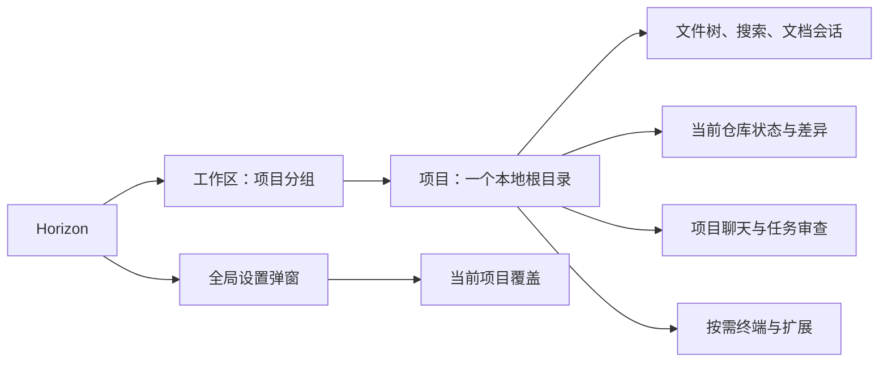
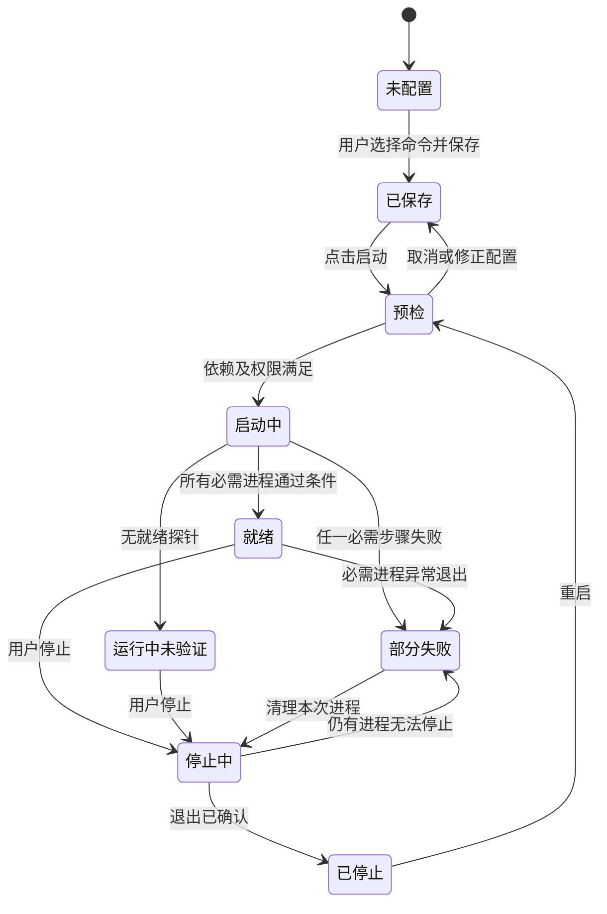
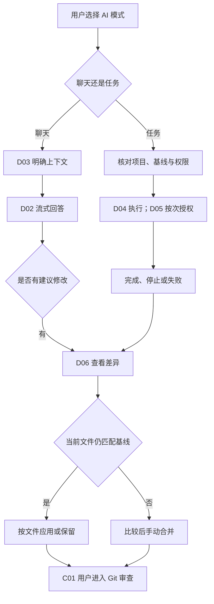

# Horizon（地平线）产品详细设计

| 项目 | 内容 |
| --- | --- |
| 文档版本 | 0.4.0；已纳入扩展优先、项目快速启动及 2026-10-31 用户确认的 Pi 默认候选范围 |
| 编写与复核日期 | 2026-10-30 至 2026-10-31，Asia/Shanghai；来源读取日期分别记录 |
| 状态 | 可进入核心编码的产品基线；界面原型、资源目标与待验证适配器不代表已经实现或验收 |
| 范围 | macOS / Windows 本地桌面工作台；最小宿主、默认附带文件树/代码/Git 扩展、多项目、外部 Agent 适配、可选终端、项目快速启动、设置 |
| 对应需求 | [REQUIREMENTS.md](REQUIREMENTS.md)，稳定编号 `REQ-*` |
| 依赖 | 当前研究、页面清单和八套布局/主题设计；技术设计负责数据结构、IPC、进程、存储、具体依赖版本及 `ADR-*`；视觉设计负责组件尺寸与主题令牌 |
| 当前事实 | 仓库处于研究和交互原型阶段。没有以本文件为依据宣称桌面端、真实 Git、AI、扩展或性能已完成 |

## 0. 当前基线与来源

2026-10-31 最终范围：最小宿主、默认能力可拆、Pi 首版唯一 Agent 候选、按需终端与项目快速启动，以及八套布局插件、独立主题、区域尺寸、图片背景和自定义配色。前端采用 React；Cordis core 进入 M0。早期研究和 design/archive 保留历史，不作为当前选型依据。

页面清单为 73 个场景：原 68 页加 F10–F14。布局/主题包分离，八套全部进入首版，不再等待择一。最新研究见 [插件调研](../architecture/PLUGIN_SYSTEM_RESEARCH.md)，具体外观规则见 [定制设计](../ux/CUSTOMIZATION_DESIGN.md)。术语“插件”与“扩展”同义。

“必须”表示所属版本验收；“建议目标”须原生实测；“后续”不计入 MVP。Web 原型不代表文件/Git/Agent/性能已经实现。

## 1. 用户、场景与产品原则

Horizon 服务于以阅读代码、审查改动和管理本地项目为主的个人开发者，也适用于让 AI 执行部分编码、自己负责理解与验收的人。首期不引入账号、组织、云同步或多人协作。

| 用户任务 | 触发场景 | 成功结果 |
| --- | --- | --- |
| 快速进入代码 | 每天打开几个本地项目，记得项目名但不记得文件完整路径 | 两次导航以内找到最近项目；快速打开定位文件；恢复上次阅读位置 |
| 审查与交付 | 外部工具或 AI 产生一批改动 | 分清未暂存、已暂存和未保存；确认提交内容；独立执行提交与推送 |
| 小幅修正 | 阅读时发现一行错误、文档错字或配置问题 | 直接编辑、查找、替换、保存；保留编码与换行信息，不必启动语言服务 |
| AI 协助理解或修改 | 按需启用 Pi 默认候选，配置模型连接，解释选区、审查差异、完成任务 | 用户知道使用哪个外部 Agent、实际权限、执行状态、改动和停止方式 |
| 一键进入开发环境 | 同一项目每天需要前端、后端及少量扩展 | 选中保存的启动方案，一键启动并看到各进程就绪；停止后资源可释放 |
| 按习惯定制 | 需要舒适阅读、紧凑审查或深色工作环境 | 可更换主题、密度、字体、布局；功能入口与状态语义一致 |

产品原则：

1. **默认聚焦阅读。**项目导航、文件树、代码区可见；AI、终端、扩展管理按需打开。配置集中到设置弹窗。
2. **扩展优先。**最小宿主只提供工作区会话、扩展生命周期、权限与资源管理、界面插槽和设置基础设施；文件树、代码、Git 都是默认附带扩展，允许暂停、禁用、卸载并恢复安装。
3. **资源跟随实际使用。**安装不等于运行，面板隐藏不等于服务停止。后台项目可休眠，未保存内容始终优先保留。
4. **结果可核对。**保存、暂存、提交、推送、应用 AI 修改是不同动作，有各自范围和真实结果。
5. **用户保持修改控制。**不能因项目切换、服务失败、取消任务或恢复会话静默覆盖文件；不能把旧差异当作当前文件的依据。
6. **美观与结构可扩展。**以 Material 的层级、状态和可访问性思想组织界面，允许多种色彩、圆角、密度和导航风格，不绑定某个组件库。
7. **本地功能独立。**没有 Git、外部 Agent 或网络时，已启用的文件扩展仍可工作；扩展失败不得使宿主失效。

## 2. 版本范围与交付门槛

| 阶段 | 必须交付 | 不代表完成的内容 |
| --- | --- | --- |
| M0 技术验证 | 最小宿主 → 默认文件/代码/Git 扩展 → 暂停/恢复/禁用/卸载的双端纵向切片；Pi 接入、只读/任务策略与资源探测；一组开发进程启动/停止 | 扩展化从第一条链路建立，不能先做大核心再声称未来可拆 |
| v0.1 核心里程碑 | 工作区与多项目、扩展化文件树/轻量编辑/搜索/Git、会话恢复、设置与主题、默认扩展恢复入口 | 可发布内部 alpha，但不能称完整 MVP |
| v0.1 完整 MVP | 核心里程碑 + Pi 默认候选适配扩展 + 经验证的聊天/任务/修改审查 + 可选终端 + 项目快速启动 + 声明式主题/本地扩展安装；双端验收 | 首版只实现 Pi，须通过版本/策略/资源/双端门槛才转为发布默认；Codex/Claude 首版仅交付接口设计，不承诺可用入口 |
| v0.2 | 块级/行级暂存、完整三栏合并器、多窗口、语义语言扩展、更多外部 Agent 适配器与启动方案能力 | 依次验证资源增量，不一次性启用所有服务 |
| 后续独立立项 | 多根项目、远程开发、调试、任意 docking、公共扩展市场、VS Code API 兼容 | 不因“mini VS Code”目标默认承诺；不立项自研 Agent 规划/工具循环/记忆 |

MVP 的每个项目只有一个文件根目录；一个工作区可包含多个项目。默认同一窗口中切换项目；保留后台会话与明确运行中的任务，不做多个项目同时全量扫描。项目下多个嵌套仓库、子模块与多仓库联合提交不属于首期聚合能力：可识别提示，用户将目标仓库单独添加为项目。

首期交付八个预装且可卸载的布局插件、独立浅深主题、区域尺寸设置、本地背景图片、自定义颜色与命名外观组合。默认启用雾蓝，布局结构仅由插件决定；详见 CUSTOMIZATION_DESIGN。

## 3. 信息架构与对象边界

| 对象 | 身份与归属 | 不包含的含义 |
| --- | --- | --- |
| 工作区 | 稳定 ID、显示名、排序及项目成员；本地组织信息 | 不等于磁盘目录、Git worktree、远端账号 |
| 项目 | 稳定 ID、规范化根路径、显示名；首期属于一个工作区 | 重命名显示名不重命名目录；切换项目不切换 Git 分支 |
| 仓库 | 项目根对应的 Git 工作树及其仓库身份；Git 操作总是显示仓库根 | 子目录项目不得无提示操作父仓库；检测到父仓库时推荐改以仓库根添加 |
| 文档 | 项目 + 文件身份、磁盘基线、编辑版本、未保存文本 | 标签页只是视图，隐藏或休眠不能丢弃文档 |
| 项目会话 | 标签顺序、当前文件、光标/滚动、树展开、搜索输入、布局、Git 提交草稿、AI 会话 | 恢复会话不代表重新执行命令、发送请求或恢复进程 |
| Agent 连接 | 外部运行时 → 模型连接两层；首期为 Pi；项目选择配置档与会话 | Agent 循环/记忆由 Pi 负责；Horizon 管理明确的 provider 配置和自管密钥引用；OAuth 归 Pi |
| 扩展 | 已安装包、启用范围、权限、依赖与运行状态 | 默认附带 Git 只是免去首次安装，不意味着不可拆除；运行时扩展不等于桌面框架插件 |
| 启动方案 | 项目内命名配置：所需扩展、一个或多个进程、顺序、就绪条件、终端/URL | 不是 Agent 编排，不自动采纳并运行仓库脚本 |

首次添加项目自动归入“默认工作区”，之后可创建和移动。默认工作区不可删除。删除其他工作区须明确将项目移动到默认工作区；不删除磁盘文件。重复添加同一规范化路径直接定位已有项目，允许显式移动分组。不同 Git worktree 路径可作为不同项目；同一文件经路径别名访问时不能产生两份相互覆盖的编辑文档。

从工作区移除项目只移除导航关联和最近入口；停止该项目服务并处理未保存内容。项目恢复草稿和历史在本地数据设置中单独清除，再添加相同路径可以恢复。F09 展示保留数据及清除入口，不能用“移除项目”暗含删除源码或会话历史。

## 4. 页面、布局与交互基线

| 页面组 | 主职责 | 默认呈现 |
| --- | --- | --- |
| A01–A06 | 首次进入、工作区、项目、克隆与项目菜单 | 首次无登录；后续恢复最后当前项目 |
| B01–B10 | 文件、编辑、搜索、预览、未保存与结构 | 文件树与代码区优先；搜索/结构复用侧栏 |
| C01–C08 | Git 状态、差异、提交、历史、分支、冲突 | 用户进入 Git 时替换侧栏内容，差异占用编辑区 |
| D01–D07 | AI 连接提示、聊天、上下文、任务、授权、审查 | 初始收起；展开不自动启动 Agent |
| E01–E16 | 终端、扩展发现/已安装、安装/授权、设置/更新、运行、禁用/卸载与恢复 | 终端按需在底部；扩展管理独立入口；E16 开发者模式后续 |
| F01–F14 | 外观、布局、编辑、资源与启动方案、外部 Agent、Git、键位、数据、尺寸、背景、配色与组合 | 设置弹窗，保留最后分类；Agent 路径、能力和启动配置不挤入主工作台 |
| G01–G07 | 渐进加载、异常、休眠、专注、深色、窄窗、Windows | 与业务页面共用状态组件 |
| H01–H05 | 信息架构、令牌、组件、适配、流程 | 设计与实现依据，不是用户必须浏览的产品页面 |

阅读预设显示项目导航、文件树、编辑区。审查预设显示项目导航、Git 更改、差异区；AI 仍按需展开。更换预设只改变布局，不重建文档、不发请求、不丢失任务。临时专注模式收起导航及辅助面板，退出时恢复进入前的可见状态和宽度；在专注模式期间发生的任务继续真实运行。

窄窗先收起辅助面板，再将侧栏变为浮层，差异改为行内。不能为了保留每个面板而将代码区挤成不可读窄栏。AI、导航浮层不同时覆盖主要编辑区域；关闭浮层恢复原焦点。尺寸断点由 H04 最终确定，必须以长中文项目名、200% 字体与 Windows 125%/150% 缩放验证。

快捷键、菜单与鼠标操作调用相同动作。`Cmd/Ctrl+P` 快速打开，输入 `>` 搜索命令；`Cmd/Ctrl+S` 保存；`Cmd/Ctrl+Shift+F` 项目搜索；`Cmd/Ctrl+,` 设置。可发现入口显示平台键位。`Esc` 先关闭当前浮层或弹窗，不把它映射为停止后台任务；任务用明确“停止”动作。界面状态必须有文字/图标，不能仅靠颜色表示修改、冲突或失败。

## 5. 设置层级、继承与生效

生效顺序为：**内置默认 → 全局用户设置 → 当前项目显式覆盖**。首期工作区只是分组，不引入工作区级设置。设置值与会话状态分开：光标、当前标签、面板临时可见状态不是设置层级。仓库原生 Git 配置由 Git 管理，不被这套继承规则隐式改写。

| 类别/页面 | 建议默认 | 可项目覆盖 | 生效与恢复继承 |
| --- | --- | --- | --- |
| 外观 F01 | 跟随系统明暗、雾蓝主题、标准密度、系统 UI 字体 | 是；字段级继承，布局与主题分别选择 | 即时预览并持久化；“恢复默认”仅重置外观 |
| 布局 F02 | 雾蓝布局插件；AI/终端隐藏 | 是：布局插件 ID、该布局允许的首选尺寸；位置由插件定义 | 每项显示“继承/项目覆盖”；恢复继承删除覆盖，不复制当前全局值 |
| 编辑 F03 | 字号 14、缩进 2 空格、长行不自动折行、自动保存关闭 | 是：字体/字号、缩进、折行、自动保存 | 影响后续编辑行为；不得为满足新缩进/换行偏好静默重写已有文件 |
| 项目与资源 F04 | 恢复上次会话；后台 5 分钟可休眠；干净文档缓存有界 | 是：休眠延迟、是否保持该项目运行 | 降低缓存上限只驱逐干净可恢复文档；未保存内容不进入自动淘汰 |
| Agent F05–F06 | Pi 为默认候选，首次使用才启用/安装；无已验证模型连接 | 是：运行时配置档、provider/model/endpoint、只读/任务选项 | 全局定义连接与凭据引用、项目选择；模型请求仍由 Pi 执行；OAuth 与自管 API key 分别标归属 |
| 扩展 E02–E03/F04 | 默认附带文件树、代码、搜索、Git；其他能力按需 | 是：继承、启用、禁用；暂停为会话动作 | 全局禁用为总开关；项目不能绕过。默认扩展也可停用/卸载；依赖处理见第 10 节 |
| 快速启动 F04/A06 | 无自动运行；打开项目不启动开发进程 | 仅项目配置；可选全局模板复制后独立保存 | 修改方案不改正在运行实例；下次启动生效；重启需明确使用新配置 |
| Git F07 | 自动本地状态刷新开启；自动 fetch 关闭；行内差异；拉取仅快进 | 是：差异形式、自动刷新、允许的拉取策略 | 新 Git 操作使用新值；运行中命令参数不变；身份沿用仓库配置 |
| 快捷键 F08 | 平台标准键位 | 否 | 冲突时列出被替换命令；替换或取消；保留恢复单项默认 |
| 数据与隐私 F09 | 本地保存会话；日志轮转；无自动源码上传 | 否 | 清理操作先展示数据种类和范围；凭据另行管理；导出默认排除密钥 |

自动保存可选“延迟 1 秒”，默认关闭；输入法组合输入期间不保存。开启时说明受影响项目，已有脏文档不立即批量保存，等待下一次编辑或显式保存。外部磁盘冲突、只读文件、AI 修改待处理时暂停对应文件的自动保存，并显示原因。

拖动面板边界会更新当前项目的布局覆盖；临时显示/隐藏更新会话状态。全局默认变更只传播到未覆盖字段。示例：全局代码字号 14，项目 A 覆盖 16；将全局改为 15 后 A 仍为 16，项目 B 为 15；A 点击恢复继承后立即为 15。

偏好开关有效即保存；输入框校验通过后保存。Agent 连接和启动方案表单用显式“保存/取消”，检测程序或握手测试不等于运行任务。无效值保留在表单并说明原因，不破坏上一个有效配置。设置弹窗有未保存表单时，关闭需“放弃表单/继续编辑”，不影响代码文档。

## 6. 工作区、项目与文件功能契约

下表中“验收”指向需求表的可验证条件；所有异步动作共同遵循第 11 节状态规则。

| 功能 / 页面 / 需求 | 入口、前置与输入 | 规则与结果 | 失败、取消与恢复 |
| --- | --- | --- | --- |
| 创建/管理工作区 A02–A03，REQ-WS-001 | 总览“新建工作区”；输入非空显示名 | 只写组织信息；可重命名、排序、移动项目；同名允许但显示项目数区分 | 校验失败留在表单；取消不创建空壳；删除按第 3 节移动项目 |
| 添加/打开项目 A01/A04，REQ-WS-002 | 本地目录选择器；可读目录；显示名和归属 | 去重后打开；先读顶层；最后活动项目更新；无 Git 仍可用 | 无权限可重试；不存在可重新定位；取消保持原当前项目 |
| 克隆 A05，REQ-WS-003 | 显式地址、目标父目录和目录名；Git 可用 | 目标须不存在或为空；显示目标与进度；完成后才注册项目，可选择立即打开 | 认证/网络失败保留表单；取消后列出残留目录，提供“保留/删除本次新建目录”；不自动清理用户已有目录 |
| 固定/改显示名/移除 A06，REQ-WS-004 | 项目菜单；输入显示名或移除动作 | 固定影响排序；改名不改路径；移除不删源码 | 有未保存内容先处理，有运行服务先停止或取消移除；失败项目仍留在列表 |
| 切换与恢复 A02/B01/G03，REQ-WS-005 | 点击项目或最近项；项目存在 | 保存会话状态后激活目标；标签、光标、滚动、搜索、提交草稿、AI 记录归各自项目 | 目标失败可回到原项目；切换不弹出未保存确认；后台状态见第 10 节 |
| 目录树 B01，REQ-FILE-001 | 当前项目；展开目录 | 按层加载；目录优先、名称排序；显示文件图标与 Git 状态；隐藏/忽略项可显式查看 | 单目录错误不清空整棵树；刷新保留仍有效选中与展开；不跟随符号链接无限递归 |
| 文件操作 B02，REQ-FILE-002 | 当前项目有写权限；新建、重命名、复制路径、系统中显示、移到废纸篓 | 名称校验、冲突不覆盖；重命名更新打开标签；删除走系统废纸篓 | 目标被占用或权限不足保持原路径；废纸篓不可用不静默改成永久删除；脏文件先处理 |
| 打开与标签 B01，REQ-FILE-003 | 文件树单击预览，双击/编辑固定；快速打开选择 | 最多一个干净临时预览标签；编辑即固定；同一文件定位已有标签；当前项目独立标签顺序 | 不支持内容用只读信息页；读取失败用 G02；关闭文档遵循 B08 |
| 快速打开/命令 B03，REQ-FILE-004 | 快捷键/搜索入口；路径或 `>` 命令 | 默认只查当前项目；支持模糊文件路径、键盘选择、最近优先；失效命令显示原因 | 无结果保留输入；取消回到原焦点；不自动执行首条命令 |
| 项目搜索 B04–B05，REQ-FILE-005 | 查询、大小写、全词、正则、包含/排除路径 | 默认尊重 Git ignore 与配置排除；按文件分组、逐批显示；点击定位对应行；搜索对象为磁盘文件 | 空查询不扫描；正则无效不启动；更换查询取消旧请求；无结果可去除限制；有未保存文本提示磁盘基线 |
| 编辑与查找 B06，REQ-FILE-006 | 可编辑文本；输入、撤销/重做、复制粘贴、文件内查找/替换 | 基础高亮覆盖 JS/TS、JSON、HTML、CSS、Markdown；未知语言纯文本可编辑；中文组合输入不拆分错误撤销 | 只读原因可见；保存失败继续保留未保存文本；不默认启动 LSP |
| 预览与结构 B07/B10，REQ-FILE-010 | 启用对应可选扩展；打开 Markdown | 源码与安全预览联动；基础标题可定位；关闭预览释放视图 | 扩展未装/异常说明原因，源码仍可读；禁用脚本及默认远程资源加载；语义符号留待语言扩展 |
| 大文件/特殊文件 B09，REQ-FILE-011 | 打开文件前已知大小/类型 | 初始建议：超过 10 MiB 或单行超过 100k 字符降级纯文本只读；超过 50 MiB 用分段只读；二进制显示元信息并可系统打开 | 显示降级原因、已加载范围；继续加载有边界；不将部分内容覆盖保存为完整文件 |

文件编码首期可靠支持 UTF-8（含 BOM）；UTF-16/其他编码识别后只读，显示编码与系统打开入口，转码编辑进入后续扩展。保存既有 UTF-8 文件保留 BOM、LF/CRLF 与末行是否换行；新文件默认 UTF-8、LF。显式修改换行与编码须展示会改变全文件的影响。文件树隐藏项、搜索排除项、AI 可发送项是不同范围，不因在树里可见就自动加入 AI。

## 7. 文档状态、保存与会话恢复

**三种基线独立：**编辑缓冲区是尚未保存的文本，磁盘是文件系统当前内容，Git 暂存区是下次提交的内容。未保存圆点与 Git `M` 可同时存在，也可只有其中一种。

| 文档状态 | 事件 | 必须行为 | 下一状态 |
| --- | --- | --- | --- |
| 干净 | 本地输入 | 记录撤销历史，标签出现圆点 | 未保存 |
| 未保存 | 保存 | 比较上次读取磁盘版本；成功写入当前编辑版本才去圆点 | 干净；若写入期间继续输入，较新编辑仍未保存 |
| 保存中 | 重复保存/关闭 | 同一文件不交错写；关闭等待保存结果 | 依结果关闭或返回未保存 |
| 干净 | 磁盘外部修改 | 重新加载，尽量保留光标；提示文件已更新 | 干净 |
| 未保存 | 磁盘外部修改 | 保留双方文本；暂停自动保存；展示“比较、重新载入、保留编辑另存为” | 冲突待处理 |
| 冲突待处理 | 比较并合并 | 合并后的结果仍为未保存；以最新磁盘版本重新执行保存校验 | 未保存/干净 |
| 任意打开状态 | 文件被删除/移动 | 保留已打开内容与原路径提示；可定位新路径、另存为或关闭 | 不可用/已恢复 |
| 未保存 | 保存权限/磁盘空间失败 | 保留完整文本与圆点；显示重试、另存为 | 未保存 |
| 未保存 | 关闭标签、关闭项目、退出 | B08：保存、放弃本次编辑、取消；批量退出可“全部保存”，按失败项返回 | 已关闭或仍打开 |
| 任意可恢复状态 | 崩溃后重启 | 列出恢复文档；与磁盘版本核对；不得自动覆盖磁盘 | 已恢复未保存/冲突待处理 |

“放弃本次编辑”只丢弃未保存缓冲区，不执行 Git 放弃更改。重新载入外部磁盘版本也需要明确放弃本地编辑。保存失败时不能继续关闭对应文档；批量操作显示逐项结果，已保存项不假装回滚。

项目切换不触发关闭确认，也不自动保存；未保存文档保留为可恢复草稿。建议编辑停止 2 秒后写本地恢复草稿，并在切换、休眠、正常退出前完成一次持久化。草稿尚未落盘或持久化失败时显示状态，禁止驱逐该文档。崩溃恢复承诺限于最后成功落盘版本，不能宣称“每个按键绝不丢失”。未解决恢复草稿不自动按缓存策略清理。

恢复会话只恢复 UI 与文档：不重放终端命令、不重发 AI 请求、不恢复被终止进程、不自动继续 Git 操作。未完成任务标记“上次会话中断”，用户核对当前状态后再重试。退出时若有活跃任务/终端，列出对象与影响，选择“停止并退出/取消”；不能因关闭窗口悄悄继续运行无入口管理的服务。

## 8. Git 产品规则

### 8.1 三份内容与差异语义

Git 更改页使用“未暂存”“已暂存”“冲突”分组。对应比较为：未暂存看 **暂存区 → 磁盘工作树**；已暂存看 **HEAD → 暂存区**。同一文件可同时出现在两个分组，点击后标题必须显示比较来源。未跟踪文件按新增内容展示；空仓库无 HEAD 时仍可查看首次提交的已暂存内容。依据：[Git diff 官方说明](https://git-scm.com/docs/git-diff)。

可验证样例：HEAD 的 `a.ts` 为 `A`，保存后暂存 `B`，再次编辑并保存为 `C`。未暂存 diff 必须为 B→C，已暂存 diff 为 A→B；提交只产生 B，提交后 C 仍为未暂存。若缓冲区又编辑成 D 尚未保存，Git 仍比较 C，标签另显示未保存圆点。

### 8.2 操作契约

| 功能 / 页面 / 需求 | 入口、前置、输入 | 规则与结果 | 失败恢复与取消 |
| --- | --- | --- | --- |
| 检测/刷新 C01/F07，REQ-GIT-001 | 打开项目或 Git 面板；Git 路径可配置 | Git 缺失、非仓库、空仓库、detached HEAD 分别呈现；展示当前仓库根和分支；刷新保留上次快照并标记时间 | 缺 Git 给安装/配置入口；失败数据标为过期，禁用依赖当前状态的写操作，重试后恢复 |
| 差异 C01/C08，REQ-GIT-002 | 选择分组与文件 | 行内默认；可并排；显示新增/删除/重命名/二进制/文件模式；超大 diff 截断并显示限制 | 刷新后版本变化使旧操作失效；不凭视觉 diff 猜测暂存内容 |
| 暂存 C02，REQ-GIT-003 | 对未暂存文件执行；或明确“暂存全部” | MVP 文件级；只暂存磁盘内容。目标文件存在未保存编辑时，提供“保存后暂存/仅暂存磁盘版本/取消”；默认不替用户选择 | 批量逐项报告；旧快照被改则刷新；不把未保存文本隐式写入磁盘 |
| 取消暂存 C02，REQ-GIT-003 | 已暂存文件；首次提交也可用 | 只移出下次提交范围，磁盘内容保持；部分暂存文件仍显示两份真实状态 | 仓库锁/状态变化保留当前状态并刷新，不做全仓重置 |
| 提交 C02，REQ-GIT-004 | 非空说明且有暂存、无未解决冲突；可见暂存清单 | 只提交暂存内容；显示身份来源；提交前重新核对暂存快照，变化则让用户再次确认范围；提交与推送是两个按钮 | hooks/签名/身份失败保留说明和当前真实暂存；不默认跳过检查；成功后清空本次提交说明并显示提交标识 |
| 历史 C03，REQ-GIT-005 | Git 面板历史入口；选择提交 | 分页历史、提交信息、作者/时间、变更文件与父提交差异；只读 | 浅克隆/历史不足显示范围；失败重试不影响当前编辑 |
| 新建/切换分支 C04，REQ-GIT-006 | 分支菜单；名称或目标；Git 写入空闲 | 新分支默认从当前 HEAD 创建并切换；MVP 切换前要求无未保存文本且工作树/暂存区干净；说明清理方式，不自动 stash 或丢弃 | 冲突、同名、锁失败留在原状态；成功后重新读取树、Git 与文档；detached HEAD 可新建分支 |
| 获取/拉取/推送 C04/C07，REQ-GIT-007 | 明确远端与分支；认证由系统/现有 Git 流程负责 | fetch 不改本地文件；MVP pull 明确仅快进，不静默 merge/rebase；push 使用显式上游，无上游先选目标并确认设置；不自动 force | 非快进给获取与检查历史入口；认证/网络失败保留改动；停止后重新查询真实状态；远端结果不明先核对，不能直接盲目重复写操作 |
| 冲突处理 C05，REQ-GIT-008 | 发现冲突，进入冲突文件 | MVP 提供冲突列表、标记跳转、手动编辑结果；“标记已解决”先保存并明确暂存该文件；检查残留标记只是提示，Git 状态才决定完成 | 未保存或仍冲突不标成功；外部 rebase/merge 显示实际模式。MVP 不做通用继续/中止编排，提供外部 Git 处理入口 |
| 放弃未暂存更改 C06，REQ-GIT-009 | 未暂存文件；明确文件清单；用户确认 | 对已跟踪文件恢复到暂存区版本，保留已暂存内容；未跟踪文件改为“移到废纸篓”；危险按钮不默认聚焦 | 有未保存文本先处理 B08；执行前核对版本；失败逐项显示；不提供含糊的“恢复所有” |

取消暂存、恢复磁盘是不同操作。Git `restore` 的目标与来源可独立指定，默认恢复来源也取决于是否操作暂存区；产品按钮必须固定上述语义，不能直接把不完整命令概念交给用户。依据：[Git restore 官方说明](https://git-scm.com/docs/git-restore)。

“仅快进”是 Horizon 首期推荐策略，避免一次“拉取”隐含新增合并提交或改写本地历史；Git 原生还支持其他整合策略。后续提供选项时须明确展现，不能依赖用户猜测配置。依据：[Git pull 官方说明](https://git-scm.com/docs/git-pull)。

### 8.3 并发与长操作

同一仓库的暂存、提交、切换分支、同步写入串行执行。不同路径但共享 Git 元数据的工作树也需由技术层正确协调。排队动作显示等待及取消入口，执行前重新校验；重复点击不能提交两次。用户可切到其他项目继续阅读，运行任务的原项目显示状态标记。

Git 命令停止不等于回滚：fetch/push 可能已经更新远端或引用，提交可能在终止前已成功。停止后进入“核对结果”，显示实际 HEAD、暂存与远端状态；结果不明不得显示“未发生任何改动”。不自动删除来源不明的锁文件。不因隐藏 Git 面板停止显式运行中的命令。

原型 C05 画出的三栏布局属于 v0.2 完整合并器；v0.1 以手动结果编辑完成必要冲突工作流。块级/行级暂存后置，但 v0.1 必须正确读取外部工具产生的部分暂存状态。

## 9. 外部 Agent：检测、使用与修改审查

### 9.1 产品责任与非目标

Horizon 负责检测、配置、启动或附着、会话入口、上下文交付、事件呈现、授权转接、修改审查和生命周期适配。规划、模型调用、工具执行循环、重试策略、Agent 记忆与会话压缩均由外部 Agent 承担。Horizon 不建设“统一模型 API + 自研 Agent”，不以自己的提示词模拟一个 Agent，也不承诺把外部 Agent 的所有能力收敛成相同 UI。

首版唯一实现的默认候选为 **Pi**，通过可暂停、禁用、卸载的适配扩展接入。**Codex CLI 与 Claude Code 首期只保留独立接口设计**，后续才实现；不为完成首版同时建设三套适配器。需要 Node/Python 等额外运行时的适配方式必须在详情说明来源和资源增量，不作为最小宿主常驻依赖。仅调用官方 Agent SDK 连接现有 Agent 运行循环不等于自研 Agent，但不能借此扩张为 Horizon 自己的工具/规划系统。

### 9.2 已核验的接入方向与能力分级

| 适配对象 | 产品推荐与官方依据 | 版本范围与能力门槛 |
| --- | --- | --- |
| Pi | 首期验证官方双向 stdio RPC，由 Pi 负责 Agent 执行；版本先锁定 v1.4.0。[CLI 集成](https://pi.dev/docs/latest/cli-integration)、[RPC](https://pi.dev/docs/latest/rpc)、[发行页](https://github.com/earendil-works/pi/releases/tag/v1.4.0) | MVP 唯一实现适配；检测/安装或定位、模型连接、只读聊天、任务权限、事件、取消、会话恢复、资源释放均须验证；候选通过后才成为发布默认 |
| Codex CLI | 后续采用官方 app-server 的会话、回合、审批与流式事件；按 CLI 生成类型核验。[官方 app-server 文档](https://developers.openai.com/codex/app-server) | 首期仅接口与能力差异设计；不展示已可用适配入口，不假设 ACP；普通终端调用不算结构化集成 |
| Claude Code | 后续使用官方程序化接口或 SDK 适配既有运行时。[程序化调用](https://code.claude.com/docs/en/headless)、[CLI 参考](https://code.claude.com/docs/en/cli-reference) | 首期仅接口与能力差异设计；普通 CLI 仍可作为用户自选终端程序，但不冒充已实现授权/工具 UI |
| 其他 Agent | 后续独立适配扩展 | ACP 只是某些 Agent 的可选协议；不假设 Codex 与 Claude 原生共用 ACP |

版本记录：Pi 官方 v1.4.0 发布页在本次核验中标记 Latest，先以该固定版本做集成验证，不运行时追随 latest。此前本机 Codex `0.166.0-alpha.5.1` / Claude `2.1.283` 只作为后续接口研究观察，不计入 MVP 运行验收。检测不能触发登录、生成请求或修改用户全局 Agent 配置。

每个适配器逐项声明并验证：认证状态可读、只读聊天可强制、结构化消息、工具事件、授权回传、变更路径、取消当前回合、停止自有进程、会话恢复、附着已有服务。UI 使用“已验证/不支持/待测试”逐项显示。仅出现可执行文件不等于这些能力都可用。

“默认候选”表示 Pi 适配包作为首选可选能力提供，首次使用才启用并安装或定位运行时；不自动下载模型、读取项目或运行 Pi。运行时安装显示固定版本、来源、平台和下载大小，经校验才启用；失败可重试但不遗留半安装可执行状态。用户自有 Pi 与 Horizon 管理的 Pi 路径分开；卸载扩展只能清理不再被使用的受管运行时，不能删除用户全局 Pi。版本升级不改变正在运行的实例，未知版本只读检测后先标未验证。验收见 REQ-AI-012。

首期 Pi 只启动受管实例或恢复其持久会话，不提供附着任意已运行 Pi TUI 的功能。未来附着只支持官方协议可确认的服务/会话，不能按 PID 把任意已有 CLI 终端接管成结构化会话。Horizon 自己启动的进程归它管理；附着的外部进程默认只断开连接，不能在停止扩展、休眠或退出时顺带终止。若支持停止远端/外部执行，按钮必须明确“请求停止该会话”，不能写成“退出 Agent”。

### 9.3 检测与连接契约

| 功能 / 页面 / 需求 | 前置、输入 | 规则与结果 | 失败/恢复 |
| --- | --- | --- | --- |
| 检测 F05/D01，REQ-AI-001 | 用户打开连接管理或点击检测；Pi 适配扩展已安装 | 显示受管/用户自有路径、版本与状态；可定位或明确安装固定运行时；不运行仓库脚本 | 未安装给安装/定位入口；权限/版本问题分开；无明确安装动作不下载 |
| 保存连接 F06，REQ-AI-001 | Pi 配置档、provider、模型、协议、endpoint、凭据引用或官方登录 | 全局定义、项目选择覆盖；自管密钥进系统存储，Pi OAuth 归其官方流程；保存不发送项目 | 无效表单保留；握手/模型测试与开始任务分开；“已配置”不等于“已验证” |
| 启动/附着 D01/D02，REQ-AI-006 | 用户明确操作；项目/工作目录与权限可见 | 按支持方式启动或附着，记录进程/会话归属；展示初始化、需要登录、就绪状态 | 初始化超时可重试/结束自有进程；拒绝登录不会使文件扩展失效；不反复自动启动 |
| 选择上下文 D03，REQ-AI-002 | 文件、选区或已暂存/未暂存差异 | 展示项目、路径、行范围、来源和大小；未保存选区标明来自编辑文本；发送时固定快照 | 默认不自动附上整仓、隐藏目录、环境/密钥文件和二进制；显式加入敏感文件另行提醒 |
| 附件预算 D03，REQ-AI-003 | 用户选取附件，适配器给出能力上限 | 初始建议 20 个文本文件、合计 256 KiB；超限要求缩小或分批；提示词与 Agent 自动读取范围分别显示 | 不静默截断；不替 Agent 重写记忆或偷偷摘要；无法精算 token 时只报字节及估算 |
| 发送/输出 D02，REQ-AI-004 | 连接就绪；有用户输入；同一会话无进行中的回合 | 交付给选定外部 Agent；原样表示可用的流式事件，保留下一条草稿；能力允许时显示工具/阶段 | 断连后先查询原会话结果再重试，避免重复执行；没有结构化事件只呈现终端状态，不臆造步骤 |
| 取消/停止 D04/D07，REQ-AI-005 | 当前回合运行中；明确停止按钮 | 取消待发消息/授权并请求中断；显示停止中；收到最终结束/退出证据才结束回合；不能停止后又执行旧队列 | 建议 3 秒后提供结束自有进程；未来附着仅断开不自动杀；保留已有修改，停止不等于撤回 |

模型请求、工具循环和会话压缩由 Pi 负责。Horizon 可在 F05/F06 编辑 Pi 支持的 provider、协议类型、endpoint 与 model；这是配置现有 Agent，不是实现第二套模型 API 执行层。自管 API key 保存在系统安全存储，只在使用时交给受管 Pi；OAuth/订阅登录走 Pi 官方流程并明确其凭据存储归属。只保存了配置显示“已配置”，用户触发无项目内容测试成功后才显示“连接已验证”。禁止把未知认证状态标成已登录，也不为绕过交互启用免审批。

Pi 支持按 provider 配置服务地址、协议与模型，这些必须分别校验，不能只看地址可连通。自定义模型服务与本地模型服务都由 Pi 连接；Horizon 不自动启动或停止用户已有推理服务。[Pi 模型配置](https://pi.dev/docs/latest/models-configuration)。Horizon 的自管密钥不得出现在任务命令环境、日志或导出中；Pi OAuth 凭据的清理由明确操作交给 Pi，不声称它天然在系统密钥库。验收见 REQ-AI-013。

消息被 Agent 接收、开始运行、一次模型输出结束和整项任务结束是不同状态。Pi 可能继续重试或压缩，UI 必须等到最终停止继续的事件并检查错误，不能收到发送成功就显示任务完成。首期不提供运行中追加/排队输入，用户保留下一条草稿；停止须清理可能存在的旧队列。[Pi RPC 命令](https://pi.dev/docs/latest/rpc-commands)。空闲受管 Pi 实例建议 60 秒后保存会话并退出，恢复时启动新实例；从未使用 AI 时 Pi 进程数必须为零。

### 9.4 聊天、任务与授权边界

| 模式 | 入口与输入 | 能力与结果 | 关键限制 |
| --- | --- | --- | --- |
| 只读聊天 D02–D03 | 用户选“聊天”、输入问题、选择上下文 | 由外部 Agent 执行已验证的只读配置，解释代码或差异 | 必须由能力/权限真正限制写入和命令，不能只靠提示词“请不要修改”；做不到时不显示有保证的只读聊天 |
| 外部 Agent 任务 D04–D05 | 用户主动切到任务；明确项目、目录、权限和 Agent | 外部 Agent 规划并执行；Horizon 呈现真实阶段、工具/授权及修改 | 一个项目同时一个任务；MVP 全应用最多 2 个运行实例，仅用户显式使用才启动第二个；不做多 Agent 调度 |
| 修改审查 D06 | Agent 修改事件或文件/Git 变化 | 查看任务基线与实际修改；按文件保留/撤回或应用建议 | 变更审查不等于 Agent 成功，不自动暂存/提交/推送 |
| 终端兼容模式 E01 | 用户启动 CLI 的终端会话 | 显示真实 CLI 输入输出，用户在 CLI 内交互 | 不假装存在未实现的结构化授权、进度、完整变更归因或一键撤回 |

首期 Pi 使用两种经过验证的配置：聊天关闭模型工具与自动项目资源发现，仅接收用户主动交付内容；任务只开放经过验证的工具集合与权限转接。聊天期间 Pi 仍可能保存自身会话，“只读”特指不执行项目工具写入。切换配置等当前回合结束后重建实例，不能只更换提示词。任务上下文标签只说明主动交付的附件；任务工具能读取的目录必须另行显示，不能把“未选文件”解释成 Agent 绝对无法读取。

D05 转接外部 Agent/受控策略扩展的真实授权请求，显示动作、命令或文件、目录、影响及请求来源，提供“允许一次/拒绝”。Pi 默认不会对每个工具动作请求批准，因此任务模式必须先验证执行前授权、拒绝无副作用、取消待处理请求与工具范围；未通过时不开放受管写任务。支持的 Pi 交互通过其正式扩展 UI 请求响应处理，不从终端文案猜测。[Pi 安全边界](https://pi.dev/docs/latest/security)、[RPC 扩展 UI](https://pi.dev/docs/latest/rpc-extension-ui)。这属于工具适配与授权，不接管 Pi 的规划/工具循环，也不宣称 OS 级强沙箱。面板隐藏不默许授权；未知请求、过期请求或策略连接失败均拒绝并显示原因。

### 9.5 修改基线、审查与恢复

Pi 首期受管写任务在明确展示的独立任务副本中运行。任务前基线由当前磁盘文件组成，包含原有已暂存/未暂存的最终内容；未跟踪文件由用户明确纳入，忽略文件默认不复制。准备副本不提交用户内容、不改变原分支或暂存区，也不自动 stash。准备过程中源文件改变须重验，不能混合不同时间点。

目标有未保存文本时提供“使用当前编辑快照/保存后开始/取消”；使用快照不先写磁盘，并同时记录原磁盘与编辑版本。首期写任务限定有有效 HEAD 的 Git 项目；无 HEAD/非仓库可聊天，写任务显示暂不支持。该限制是当前快照实现范围，不是要求用户先清空已有改动。副本实现细节见[Pi 架构研究](../architecture/PI_AGENT_RESEARCH.md)，产品验收重点是原工作内容保留、审查基线清楚、应用检查版本。

当前项目后来又被用户或外部工具修改时，不能直接覆盖。应用到打开的文档应进入可撤销的编辑缓冲区并保持未保存；关闭文档的文件在确认后写磁盘，并报告成功/失败。任务副本的“放弃结果”只放弃候选，不重置原工作树。未来直写 Agent 或用户自行运行的终端模式，应使用“已修改，待审查”语义，不冒充未应用建议。

| 结果类型 | D06 比较与文案 | 保留/应用 | 拒绝/撤回 |
| --- | --- | --- | --- |
| 尚未写入的建议/独立副本结果 | 原始基线 → 建议；“待应用” | 校验原磁盘与编辑版本；打开文档通过可撤销编辑应用，其他文件确认后写盘；不改暂存区 | 拒绝只移除候选，不改当前文件 |
| 已写入当前项目且有完整快照 | 任务前 → 任务后；“已修改，待审查” | “保留修改”仅记录决定，不再次写入 | 当前仍等于任务结果且无后续暂存/编辑时，才可恢复任务前内容；存在后续变化则改为比较 |
| 只有 Git/磁盘差异，无法完整归因 | 当前真实差异；“变化来源未完全确认” | 用户可普通阅读/编辑与 Git 审查 | 不提供假定能精确移除 Agent 改动的一键撤回 |
| 用户/外部工具又修改文件 | 基线、Agent 结果、当前内容三方可核对 | 禁用旧补丁直接应用；用户比较后合并为新编辑 | 不覆盖后续改动，保留可用快照 |

首期按文件审查；多文件应用逐项报告，不能声称跨文件原子回滚。新增/删除/重命名、超大文件、二进制及项目外变化显示各自限制。停止、失败、断连后仍保留已发生变更；外部 Agent 报“完成”之后也必须重新核对文件状态。Horizon 不自动执行 Git 提交或推送，外部 Agent 已执行的动作则如实记录，不能逆称“未提交”。

## 10. 最小宿主、扩展与项目快速启动

### 10.1 宿主与默认附带扩展

| 层 | 职责 | 产品边界 |
| --- | --- | --- |
| 最小宿主 | 窗口与工作区/项目身份、设置/会话与恢复存储、扩展管理/安装入口、命令与面板插槽、权限/资源/进程归属、基础通知 | 无论其他扩展如何停用，仍能进入设置、管理项目、恢复默认扩展和导出恢复草稿；宿主自身不是一个可卸载扩展 |
| 默认附带扩展 | 文件树、代码阅读/轻量编辑、搜索、Git、基础语言高亮及主题资源 | 首次使用已安装、按需激活；均显示来源与依赖，可暂停/禁用/卸载；卸载后不偷偷在核心保留等价后台服务 |
| 可选扩展 | 终端、项目快速启动、Pi 运行时及适配实例、Markdown 预览、其他语言服务等 | 不启用时无对应常驻进程；用户可安装/启用；默认安装包是否携带静态资源不等于默认运行 |

“内置 Git”指开箱已附带、入口整合与一致体验，不表示不可拆。文件/代码扩展也走真实安装、激活与释放契约；不能仅把页面目录改名为 extension。默认扩展包可从可信本地随包资源恢复，用户卸载时移除活动安装及注册；原安装介质是否仍有压缩副本须在磁盘占用口径中说清。

扩展管理和恢复草稿能力归宿主，避免停用编辑扩展后无处恢复数据。停用前未保存文档必须保存、导出/保留可恢复草稿或取消；扩展无法导出必要恢复状态时禁止强行卸载并给出具体对象，不把数据保护理由扩展为默认扩展永远不可卸载。

### 10.2 生命周期、依赖与作用域

| 动作/状态 | 运行与数据含义 | 恢复与依赖规则 |
| --- | --- | --- |
| 已安装未启用 | 包在磁盘，代码未激活 | 显式启用前校验兼容版本、权限与依赖 |
| 已启用休眠 | 允许响应激活事件，当前无实例 | 执行命令/打开视图时激活；不是暂停 |
| 正在运行 | 有视图、请求、监听或进程等活动资源 | 显示实际所属项目和资源；不以面板可见性判断 |
| 暂停 | 可选当前项目或所有项目；停止相应实例，释放资源，保留启用策略、配置及恢复状态；所选范围不自动再激活 | 手动暂停标记跨应用重启保留，直到用户“恢复”或确认启动方案临时恢复；不保证冻结外部进程后原地续跑 |
| 禁用 | 持久关闭自动激活与入口注册；停止对应范围实例 | 项目禁用只影响该项目；全局禁用影响所有项目；重新启用仍按需激活 |
| 卸载 | 全局删除安装包、注册与运行实例；配置/历史单独可选清理 | 列出受影响项目和依赖；可以取消或一并禁用依赖者；不卸载系统 Git/外部 Agent 程序，不删除源码 |
| 异常/停止失败 | 实例未正常完成启动/退出 | 明确是否仍占用资源，提供重试、结束自有进程、禁用；不能提前显示“已停止” |

启用解析顺序：包存在且兼容 → 全局未禁用 → 项目继承/启用/禁用 → 依赖可用 → 权限满足 → 非暂停 → 激活事件。全局禁用是总开关；项目“启用”不能绕过它，需用户先修改全局设置。安装/卸载全局生效；项目只控制实例与选择，不复制多个包。

依赖分为必需与可选。缺必需依赖不启动，列出缺失项及安装/启用方案；可选依赖缺失只关闭对应能力。依赖循环或版本不兼容在安装/启用前拒绝。停用依赖前显示受影响者，可选择“同时停用依赖者/取消”；不能自动重新启用已被用户禁用的依赖。示例：代码扩展依赖文档基础能力、Markdown 预览依赖代码上下文；禁用代码扩展时预览一起停用，Git 的纯状态列表仍可独立运行，差异编辑能力按依赖降级。

同一扩展为多个项目使用时，暂停项目 A 不能结束项目 B 的实例或共享服务。全局停用前聚合展示所有受影响任务、终端与未保存文档。替换扩展版本先停止旧实例；新增权限重新授权，升级失败保留可恢复版本/状态，不能清空用户配置。

### 10.3 轻量预设与功能恢复

预设只决定扩展启用与激活偏好，不删除安装包或用户数据：

| 预设 | 默认启用 | 初始运行 |
| --- | --- | --- |
| 极简阅读 | 文件树、代码、基础高亮、搜索、主题 | 只激活当前文件需要的能力；Git/Agent/终端关闭 |
| 代码审查（首次默认） | 阅读能力 + Git | 当前项目文件与 Git 必要状态；Agent/终端/语言服务不启动 |
| 项目开发 | 阅读/Git + 用户选定快速启动与终端扩展 | 选择预设只准备能力，仍需点击启动方案才运行进程 |
| 自定义 | 用户逐项选择 | 所有服务按激活事件运行 |

应用预设前展示新增启用、停止和受影响任务；有未保存内容/活跃进程时使用统一处理流程，取消不改配置。不自动联网安装缺包：列清单供用户明确安装。删除文件树扩展后 B01 显示可恢复入口与已安装替代者；没有代码扩展时文件可系统打开，宿主仍能管理项目和恢复扩展。

### 10.4 面板、休眠与终端

| 用户动作 | UI 与运行资源 | 数据与恢复 |
| --- | --- | --- |
| 隐藏面板 | AI/Git/终端面板收起，显式任务仍运行，项目保留状态标记 | 再开恢复原实例；不重复创建会话 |
| 关闭聊天视图 | 有运行任务则选择后台继续或停止 | 关闭不是删除聊天或结束整个外部 Agent |
| 取消 Agent 回合 | 先请求中断，显示停止中 | 变更保留；外部进程可能仍处于就绪待命 |
| 暂停 Agent 扩展 | 中断/结束自有活动实例；附着实例断开 | 恢复后按外部协议恢复会话，不声称恢复冻结的进程 |
| 结束终端会话 | 明确终止 shell 及其受管进程树 | 有界历史可保留，不重放命令 |
| 后台项目休眠 | 停止可恢复实例与非交互扫描、释放干净视图 | 保留会话与落盘草稿；唤醒核对磁盘；已手动暂停/禁用的扩展不自动恢复 |
| 全局退出 | 列出自有任务、启动方案、终端与外部附着 | 自有进程停止后退出；附着默认断开；不重启时自动重放进程 |

默认后台 5 分钟且无 Git 写入、Agent 回合、终端、启动方案或未落盘草稿时可休眠。有活跃进程时说明阻止休眠的对象，提供“停止这些服务并休眠/取消”。没有输出不等于进程可结束；操作系统挂起也不等于 Horizon 已停止服务。低内存先释放干净缓存，不杀活跃工作或丢弃草稿。

终端是可选扩展 E01，点击新建才启动 shell，绑定明确项目与工作目录；切换项目不改变已有终端。显示会话、状态、复制/输入、重命名与结束入口；建议每项目最多 3 个手动会话，启动方案会话另列归属。关闭面板不结束进程；关闭会话先说明其中运行任务。进程启动失败保留日志与重试；外部脱管守护进程不能仅凭 shell 退出就称已停止。

### 10.5 项目快速启动：配置与运行

快速启动是 MVP 可选扩展（REQ-LAUNCH-*），使用宿主进程管理能力；展示终端时依赖终端扩展，无终端时仍能以有界日志列表呈现后台进程。入口为项目菜单 A06 的“启动方案”、F04 管理、工作台的单个启动/停止按钮；详细编辑与依赖配置留在设置弹窗。E01 展示运行组与输出。页面新增由主设计会话分配 ID。

**方案字段：**名称、所属项目、所需扩展与版本条件、进程列表、每进程名称/可执行文件与参数或显式 shell 命令/工作目录/环境变量引用/前置依赖/就绪规则/启动超时/结束策略，以及就绪后可打开的本地或明确配置的 URL。首期依赖图仅用于开发进程启动顺序，不涉及 Agent 决策。工作目录默认项目根；项目外目录必须明确显示。密钥使用凭据引用，日志与导出脱敏；不可把完整环境变量值默认展示在日志。

| 操作 | 前置与输入 | 规则与结果 | 失败、取消与恢复 |
| --- | --- | --- | --- |
| 发现候选 | 用户点击“发现启动命令”；读取 package.json 等声明 | 仅列名称、原始命令、来源文件、工作目录；用户选择后保存方案 | 不执行脚本探测，不因为打开/克隆项目自动安装依赖或启动服务器 |
| 新建/编辑 | 配置字段、平台差异、就绪条件 | 校验必填、路径、依赖环和 URL；保存配置；运行中实例使用其启动时快照 | 校验失败保留表单；取消不改旧方案；平台不支持的命令在启动前指出 |
| 启动预检 | 用户点击已保存方案；核对配置版本、扩展、权限、目录与可执行程序 | 一次列出缺包、禁用/暂停依赖、端口冲突与会影响的现有实例；用户处理后才执行 | 不静默安装、启用全局禁用扩展或杀占用端口的其他进程；可修改配置/取消 |
| 一键启动 | 预检通过；已授权该方案与所需能力 | 启用所需扩展的当前运行实例，按依赖启动多个进程；每个记录 PID/进程归属/开始时间/日志 | 配置改动、新权限或新命令需重新审阅；不要求每次重复批准未变化的已保存方案 |
| 就绪检测 | 用户选无探针、成功退出、日志匹配、端口或 HTTP 检查 | 常驻进程无探针只能标“运行中，就绪未验证”；一次性步骤成功退出才满足后续依赖；探针通过才标“就绪” | 超时标失败/未就绪并保留日志；端口响应还要关联本次实例，不能把原有进程响应当本次成功 |
| 打开终端/URL | 方案中保存了目标与触发条件 | 终端定位本次进程；URL 默认用户点击，保存了“就绪后自动打开”则在就绪后每次运行一次 | 不自动打开日志中任意 URL；未就绪/失败不弹浏览器；重试不重复开一堆页面 |
| 停止 | 某进程或整个运行组 | 先停止依赖者，再停止依赖；优雅终止后超时可结束自有进程树；显示停止中及逐项结果 | 不杀非本次拥有的进程；未确认退出不标停止；停止不撤回脚本产生的文件/外部副作用 |
| 重启 | 选择失败进程/运行组；显示配置版本 | 默认先完整停止选择范围再按最新已保存方案启动；重复点击合并为一次请求 | 停止未完成不启动第二份；配置变化展示差异；依赖者受影响明确列出 |
| 删除方案 | 无运行实例，或先停止 | 只删配置；不删除源码、依赖包或输出文件 | 活跃实例仍在时提供停止后删除/取消；不能删除后留下无管理入口的运行组 |

首次授权的是明确命令、目录、环境引用与外部影响。仓库脚本内容改变，即使命令名不变，也须在下一次运行前提示来源已变化并重新核对；用户从仓库导入的方案默认未授权。允许用户选定全局模板复制为项目方案，之后独立编辑；首期不自动同步仓库中的任意启动配置。

**失败策略默认：**任一必需进程启动/就绪失败，停止继续启动依赖它的进程，并停止本次运行中新启动的受管进程；不影响本来已运行、未归本次所有的服务。停止失败则运行组为“部分失败，仍有进程运行”，保留停止入口。用户可在方案中显式选“保留已启动进程以排错”，但不默认无限自动重启。

同一项目同一方案默认只允许一个实例；重复启动定位原实例。多个不同方案需要共享进程时，MVP 不自动合并或夺取所有权，预检提示冲突，由用户修改或复用已有方案。运行组活跃时项目不能自动休眠；切换项目或隐藏面板不停止它。退出/停用快速启动扩展时必须停止自有运行组或取消操作。终端只承载视图时，停用终端不会暗中结束由快速启动扩展拥有的进程，但输出转到日志列表；若进程确实依赖 PTY 能力，则在依赖确认中一并停止。

启动方案只为本次运行临时启用或恢复的扩展，必须记录启动前状态。停止后仅释放本次使用权；没有其他使用者且用户未在运行期间主动改动设置时恢复原状态，包括恢复原暂停标记。用户可在预检选择“同时保存为项目启用”，此时才持久改变项目策略。全局禁用仍须显式解除。已有实例或其他项目共用的服务不能因为本次方案结束而被关闭。

### 10.6 扩展异常与真实验收

扩展详情 E03 显示来源、版本、依赖、权限、作用域、激活条件和资源状态；不虚构尚未测量的 MB 数。E04 将异常限制在对应扩展，宿主和独立扩展仍可用；日志脱敏，提供重试/暂停/禁用。异常扩展不得自动无限重启。

新增页面按同一契约实现：E05 已安装与作用域；E06–E08 本地包检查、安装进度/取消与授权；E09 扩展设置继承；E10–E11 更新及新增权限；E12 运行/休眠/暂停；E13 禁用范围；E14 卸载；E15 空状态与恢复。首次安装流程先说明并确认声明权限，未同意可取消，不注册半成品；安装后允许保持未启用，执行时仍检查有效权限。E02 的发现首期展示默认附带、可选能力与本地包入口，不以公共市场为前提。E16 开发者目录加载和重载明确为后续，不阻塞 MVP 本地包链路。

首条验收链路必须覆盖默认 Git 扩展的卸载与恢复安装，以及外部只读示例扩展的本地安装、命令激活、暂停、恢复、禁用、卸载和资源释放。仅提供主题 JSON、模块目录或模拟开关不能算扩展架构完成。公共市场、评分、账号、VSIX 兼容都不属于这条验收的前提。

## 11. 通用状态与典型流程

| 状态 | 展示与可操作项 | 禁止行为 |
| --- | --- | --- |
| 空 | 空工作区引导添加项目；空项目仍显示根；无更改显示干净；无 Agent 提示检测/配置；功能扩展缺失给恢复入口 | 不自动创建示例代码、仓库或连接 |
| 加载 | G01 先显示壳与已知结构，局部加载；可取消可取消的操作；长耗时显示真实阶段 | 不伪造进度百分比；不为一个目录失败锁住整个窗口 |
| 无结果 | B05 保留查询、范围、选项，提供修改范围 | 不清空用户输入，不把未完成搜索当成零结果 |
| 失败 | 保留输入/最后有效结果，标过期，给具体恢复动作；日志详情可展开 | 不用成功提示掩盖失败，不默认重试外部写操作 |
| 取消中 | 立即反馈请求停止；等待实际结果 | 不将按钮点击等同于操作已终止 |
| 已取消 | 保留已完成的真实部分及恢复入口 | 不承诺回滚已完成写入、网络请求或远端动作 |
| 未保存 | 标签圆点、退出前处理、恢复草稿 | 不用 Git `M` 代替；不因切换/休眠丢失 |
| 状态过期/离线 | 标出最后刷新，允许本地阅读；禁用需最新基线的写入 | 不将缓存当成实时数据 |
| 待授权 | 可见请求归属和影响，允许一次/拒绝；项目有标记 | 不因隐藏面板默认允许，不跨项目套用授权 |

**打开项目与轻量编辑：**A01/A02 → A04 选目录 → G01 渐进加载 → B01 文件树 → B03 定位 → B06 编辑 → 保存校验 → B08 关闭。取消选目录留在原项目；保存冲突进入比较，不能继续覆盖。

**Git 审查与交付：**C01 选择未暂存文件 → C08/行内差异 → C02 暂存 → 选择已暂存分组复核 → 输入说明提交 → C04 单独推送。任何步骤出错留在对应阶段，不自动升级为 force push、全量暂存或跳过 hooks。

**启用扩展：**E02 选择本地包/内置能力 → E03 核对来源、版本、权限 → 安装/启用 → 休眠 → 首次实际使用激活 → 停用释放。异常走 E04；停用验证服务确实结束，不只让菜单消失。

**项目快速启动：**A06/F04 发现候选 → 用户选择与保存 → 预检扩展、命令、目录和权限 → 启动组 → E01 查看每个进程状态 → 就绪后打开指定 URL → 停止/重启。退出或休眠复用运行组清单；不把隐藏终端当作停止开发服务器。

## 12. 非功能需求与资源预算

### 12.1 建议目标与测量口径

以下继承研究中的初始预算，**全部为建议目标，当前无实测结果**。M0 生成真实双端报告后可经记录调整，不能用 HTML 原型帧率、安装包体积或单一 JS heap 证明达标。

| 场景 | 建议目标 | 前提 |
| --- | --- | --- |
| 空工作区常驻内存 | ≤ 200 MB | release 包，稳定 60 秒，所有可归属进程 |
| 日常阅读常驻内存 | ≤ 350 MB | 1 万源码文件，5 个 ≤ 200 KB 标签；Git 就绪；无 Agent/LSP/终端 |
| 差异 + 外部 Agent 会话显示（Horizon 部分） | ≤ 450 MB | 10 个改动文件、约 2,000 行 diff；有界记录；必须同时另报含外部 Agent 的全工作流总量，不把此行宣称为整体预算 |
| Pi 工作流组合总量 | 建议 ≤ 600 MB；Pi 空闲实例增量建议 ≤ 120 MB | 采纳 Pi 架构研究的新增待测预算；一个 Pi 实例、远程模型；包含 Horizon/WebView/Pi 及相关 helper，峰值另报；第二实例与本地模型另列增量/总量 |
| 冷启动到可交互 | P95 ≤ 2 秒 | 本地 SSD；20 次独立启动，明确 OS 缓存条件 |
| 热缓存文件打开至可读高亮 | P95 ≤ 150 ms | ≤ 200 KB；首次打开另外报告 |
| 稳定空闲 CPU | 60 秒平均 ≤ 单核 1% | 无流式响应、搜索和显式后台任务 |
| 资源释放 | 30 分钟开关项目/面板后无持续增长趋势；无应已停止的受管进程 | 记录稳定值、峰值和活动资源数量，不能只看一次终点 |

macOS 记录应用及关联进程 footprint；Windows 分别报告 private working set 和 private bytes，并注明预算比较口径。WebView/GPU 关联资源不能因不在简单父子 PID 树中而漏计。开启 Agent、LSP、终端、本地模型后报告增量和全工作流总量；本地模型的 GB 级内存不纳入“基础阅读 350 MB”的承诺。

资源策略必须可观察：初始只读取必要目录和文件；搜索与 diff 分批有界；建议搜索上限 10,000 条匹配并提示“结果已截断”；干净文档缓存建议上限 20 份且合计 64 MiB，先到限制即淘汰；聊天、终端输出和日志有界分页。未保存文档超出预算时持久化后卸载视图，不能删除草稿。上限集中在资源设置或能力说明，不能表现为无解释的内容缺失。

### 12.2 双端、可访问性与可靠性

首期目标架构为 macOS arm64/x64、Windows x64；最低系统版本由 M0 在 Tauri/WebView、输入法、Git 与安装器联合验证后确定。Windows ARM64 与 Linux 后置。macOS/Windows 均须真实运行以下验收：中文组合输入、保存与外部变更冲突、Unicode/空格路径、大小写及符号链接、文件占用、系统凭据、任务停止和安装卸载。

键盘可到达全部核心操作；弹窗聚焦并可返回触发点；图标按钮有名称；文件树、标签、差异和状态可由辅助技术识别。提供清晰焦点、非颜色状态、字体缩放、减少动画；浅深主题分别验收，不做简单反色。Material 风格与无障碍要求通过 H02–H04 的组件规范落实。

Horizon 配置和会话只存本地；由 Horizon 管理的凭据引用使用系统安全存储，外部 Agent 的认证与历史保留遵循其自身设置，不能在 Horizon 中声称已代为清除。宿主诊断日志不含 token、Authorization 值、完整提示词或源码正文；终端/任务本身的输出可含用户程序内容，导出前可预览并脱敏。导出设置默认去除密钥、历史正文和机器绝对路径。清理缓存、聊天、恢复草稿和凭据是分开的动作；不以“清理缓存”删除未保存恢复内容。没有用户主动动作时 Horizon 不发送源码到网络，不自动采集遥测。

安装器应检测必要运行时，升级保留设置和会话，卸载不得删除用户项目；是否删除应用数据由明确选项控制。Git 可执行文件依赖在安装/首次使用说明中可见，但不能阻断非 Git 阅读。离线仍能打开、编辑、搜索和本地 Git；仅远程能力显示离线。

## 13. 验收组织、决策与待确认

### 13.1 可直接进入实施的验收工作包

以下 `TASK-PROD-*` 是产品验收工作包，技术实施计划可引用并拆分，不替代技术任务编号。

| 工作包 | 对应需求族 | 可验证出口 |
| --- | --- | --- |
| TASK-PROD-001 会话与数据 | REQ-WS、REQ-FILE、REQ-STATE | 三个项目切换、脏文档恢复、路径失效、保存竞态与崩溃恢复均有确定结果 |
| TASK-PROD-002 Git 正确性 | REQ-GIT | A→B→C 部分暂存样例、空仓库、hooks 失败、非快进、取消结果核对通过 |
| TASK-PROD-003 外部 Agent 边界 | REQ-AI | Pi 固定版本探测、模型配置、能力分级、真实取消/授权、旧补丁冲突、原用户改动保留；Codex/Claude 只验收接口设计 |
| TASK-PROD-004 扩展纵向切片 | REQ-HOST、REQ-RUN、REQ-EXT | 默认 Git/文件扩展可拆、暂停/禁用/卸载有不同效果；隐藏继续、停止结束、休眠释放、唤醒重验 |
| TASK-PROD-005 设置与视觉 | REQ-SET、REQ-UI | 继承样例、主题切换、布局恢复、键盘与窄窗、两种系统键位通过 |
| TASK-PROD-006 双端发布 | REQ-NFR | release 包、固定样本性能报告、真实安装升级卸载和完整主流程通过 |
| TASK-PROD-007 项目快速启动 | REQ-LAUNCH | 候选不执行、方案可保存、双进程就绪/失败、端口冲突、停止与重启、依赖/所有权正确 |

推荐测试样本包括：普通项目、非仓库、空仓库、部分暂存仓库、带原有脏内容的 AI 项目、冲突仓库、1 万/10 万路径项目、10/50 MiB 边界文件、100k 字符单行、中文与换行路径。指标报告和功能通过证据必须记录构建、系统、样本与扩展启用状态。需求表全部通过才可标记对应版本完成；现在全部处于“设计待实现”。

### 13.2 已作推荐，不作为编码阻塞

| 问题 | 产品推荐 | 依据/影响 |
| --- | --- | --- |
| 单项目还是多项目首期 | 多项目导航，单当前项目，一个项目一个根 | 用户当前目标与 A02–A04 优先于早期研究 |
| 多种 Material 风格如何实现 | 业务状态共用；主题/密度/布局分别配置；八个预设均为布局插件，主题独立组合 | 视觉差异不应复制 Git/AI/编辑逻辑 |
| Git 操作深度 | 文件级写操作闭环；读取部分暂存；仅快进拉取；三栏/逐块后续 | 先保证真实基线与可恢复性 |
| AI 聊天是否可执行 | 只有外部 Agent 确实能限制写入时才提供只读聊天；任务显式开启 | D02、D04–D06 不以提示词冒充权限 |
| 修改归因与撤回 | Pi 首期任务副本包含原用户改动与可选编辑快照；应用检查双方版本；其他直写来源完整归因才精确撤回 | 不改原分支/index，不伪造回滚；无 HEAD/非仓库先支持聊天 |
| 扩展范围 | 默认文件树/代码/Git 可拆；最小宿主 + 第一阶段真实扩展切片 | 用户补充明确将扩展化设为核心卖点 |
| Agent 接入 | Pi 为首版唯一实现的默认候选；Codex/Claude 仅接口设计；不自研 Agent | 2026-10-31 用户确认；Pi 资料与架构研究支持先验证一套完整链路 |
| 快速启动 | 用户保存方案后显式启动；管理扩展依赖、多个进程与就绪/停止 | 一键进入项目环境，同时保持按需资源策略 |
| 技术路线 | 支持 Tauri 2 + Rust + React / TypeScript + CodeMirror 6 + Cordis core 进入 M0 | 系统 WebView 与可定制 Web UI 契合方向；并非性能已获证明 |

**当前无阻塞开工的用户问题。**八套布局均交付，默认雾蓝可切换。最低系统版本和精确依赖在 M0 固定；双端性能与签名仍须实测/发布证据。

**发布门槛而非全局编码阻塞：**默认扩展可拆纵向切片、Pi 的实际协议、策略与数据保护验证、启动方案进程归属/停止验证、系统安全凭据存储、双端安装签名/运行时策略及资源预算报告。未达门槛时相关功能保持不可用或 alpha 标识，不能以演示替代交付。

## 14. 官方资料核验记录

资料核验发生于 2026-10-30 至 2026-10-31。此表记录此次实际能核验的文档/版本，不是依赖锁文件；具体包版本由技术设计统一选定，不把“Latest”网页标签等同于所有包的最新版本。

| 资料 | 此次核验 | 对产品规则的作用 |
| --- | --- | --- |
| [Tauri 进程模型](https://v2.tauri.app/concept/process-model/)；[发布页](https://v2.tauri.app/release/) | v2 文档；发布页列出 `tauri` / `@tauri-apps/api` 2.12.3，CLI 2.12.2 | 系统 WebView、多进程和平台差异；内存须统计所有相关进程，不能只看主程序 |
| [React useSyncExternalStore](https://react.dev/reference/react/useSyncExternalStore) | 0.4 使用 React；Cordis 样例已验证外部快照订阅与清理 | 原生 WebView、CodeMirror 与内存仍须 M0 验证 |
| [CodeMirror view 官方仓库镜像](https://github.com/codemirror/view/blob/main/package.json) | 镜像声明 6.41.0，已标归档并指向新上游；官网指南此次返回 403，新上游此次未能读取 | 只确认候选为模块化 6.x 系列；当前可安装版本、合并视图与 IME 支持交由 M0 重新核验，不能把归档镜像当最新版本 |
| [Git diff](https://git-scm.com/docs/git-diff)、[restore](https://git-scm.com/docs/git-restore)、[pull](https://git-scm.com/docs/git-pull) | diff 文档更新至 2.56.0；restore 最新内容为 2.55.0、2.56.0 无变更；pull 读取当前官方手册 | 分清 HEAD/暂存区/工作树、恢复目标与快进策略；不要求用户为了这些基础语义强制安装最新 Git |
| [Pi v1.4.0](https://github.com/earendil-works/pi/releases/tag/v1.4.0)、[CLI 集成](https://pi.dev/docs/latest/cli-integration)、[RPC](https://pi.dev/docs/latest/rpc) | 发行页标 v1.4.0 Latest；当前文档描述双向 JSONL RPC；本轮未安装 Pi 或发送模型请求 | 首版默认候选与协议方向；正式默认取决于策略、资源与双端实测 |
| [Pi 模型配置](https://pi.dev/docs/latest/models-configuration)、[安全](https://pi.dev/docs/latest/security)、[扩展 UI](https://pi.dev/docs/latest/rpc-extension-ui) | 已读取当前官方文档；provider 配置与执行前授权必须按固定版本验证 | 不把原生 Pi 当默认逐操作审批沙箱；Horizon 提供配置与受控工具适配，循环仍归 Pi |
| [Codex app-server](https://developers.openai.com/codex/app-server) | 已读取当前官方协议文档；本机 CLI 为 `0.166.0-alpha.5.1`；文档明确支持按 CLI 版本生成协议类型 | 后续独立适配路径，首版仅接口设计；优先 stdio，实验能力单独验证；不是 ACP |
| [Claude Code 程序化模式](https://code.claude.com/docs/en/headless)、[CLI 参考](https://code.claude.com/docs/en/cli-reference) | 已读取当前官方文档；本机 `2.1.283`；文档部分能力有更高版本要求，不能假定本机全部支持 | structured output、恢复、授权与停止分别核验；实际 CLI/SDK 运行 Agent 循环，Horizon 只适配 |
| [ACP v1](https://agentclientprotocol.com/protocol/v1/prompt-turn) | 官网标 v1 Latest、v2 Draft；记录为未来其他适配器的候选 | 不用该协议替代 Codex/Claude 官方接口，不假定任意 Agent 均支持 |

正文中的具体范围、默认值、资源上限和验收规则是 Horizon 产品推荐；引用用于证明技术语义，不表示这些官方项目已经实现 Horizon 的工作流。
